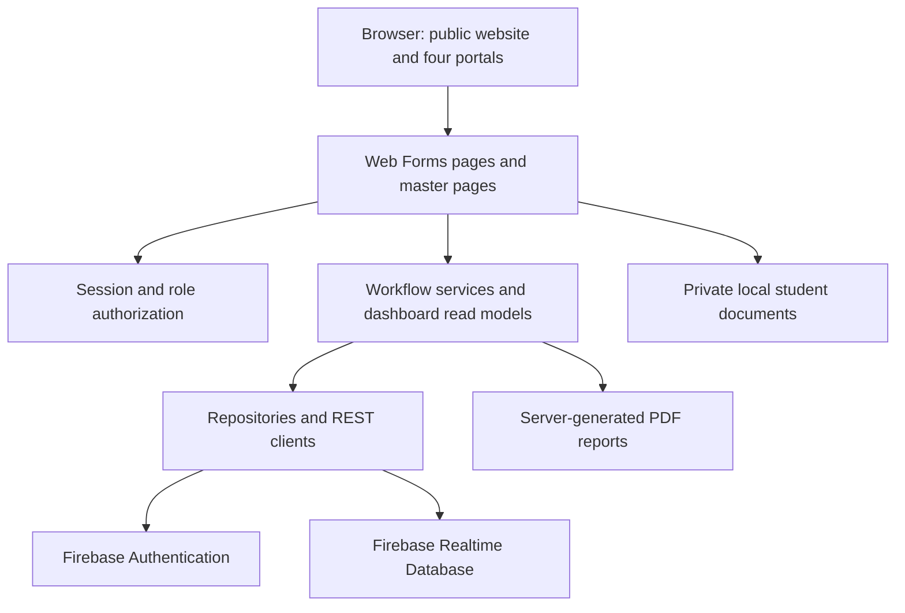

<div align="center">


# University Internship Management System

**UIMS · One workspace for the university internship journey**

Discover opportunities. Coordinate placements. Review work. Follow progress.

**Student · Company Supervisor · Academic Supervisor · University Coordinator**

ASP.NET Web Forms · C# · .NET Framework 4.7.2 · Firebase · Three.js

Orange Academy · Group 4 · Academic team project

</div>

---

## Overview

UIMS connects internship recruitment, supervision, and administration in one bilingual website. Students discover opportunities and follow their work; companies manage recruitment and trainees; academic supervisors monitor assigned students; university coordinators oversee accounts, groups, placements, and completion decisions.

The project combines practical administrative workflows with a university-focused identity: interactive dashboards, English/Arabic layouts, Light/Dark themes, and optional 3D campus experiences. Its current academic configuration targets the **German Jordanian University School of Computing**.

This README describes the implementation in this repository. Some workflow services still require page-level integration; see [Implementation status](#implementation-status) before planning an end-to-end demonstration or deployment. Academic thresholds in the source are provisional project defaults, not verified university regulations.

## Contents

- [Platform highlights](#platform-highlights)
- [Four connected role portals](#four-connected-role-portals)
- [Internship workflow](#internship-workflow)
- [Public website and shared features](#public-website-and-shared-features)
- [Design, accessibility, and localization](#design-accessibility-and-localization)
- [Architecture and technology](#architecture-and-technology)
- [Data and document handling](#data-and-document-handling)
- [Authentication and authorization](#authentication-and-authorization)
- [Getting started](#getting-started)
- [Configuration and deployment](#configuration-and-deployment)
- [Verification](#verification)
- [Implementation status](#implementation-status)
- [Repository structure](#repository-structure)
- [Documentation and contribution](#documentation-and-contribution)
- [Credits and licensing](#credits-and-licensing)

## Platform highlights

| Capability | What UIMS provides |
| --- | --- |
| Four role-specific workspaces | Separate navigation, dashboards, permissions, and operational pages. |
| Connected application journey | Opportunity discovery, applications, company decisions, and student confirmation of an accepted offer. |
| Structured task review | Assignments, submission attempts, criteria, grades, feedback, and revision requests. |
| Progress visibility | Placement details, task progress, recorded hours, evaluation status, and completion review. |
| Interactive analytics | Role-scoped data, animated KPIs, chart interactions, and detail views. |
| Bilingual navigation | Server-side English/Arabic resources, LTR/RTL layouts, and a saved language preference. |
| Consistent workspace controls | Shared sidebar, mobile navigation, themes, notifications, and account access. |
| University-inspired presentation | Campus storytelling, security-gate login, team lecture hall, and readable fallbacks. |

## Four connected role portals

Paths below are relative to the web application root. Short filenames in a row share the preceding role directory. `Company` represents company supervisors; `Academic` represents academic supervisors.

### Student

The student portal focuses on finding a placement and understanding the next step.

| Area | Current capabilities | Main pages |
| --- | --- | --- |
| Dashboard | Internship journey, progress summaries, task information, and interactive analytics. | `Pages/Student/Dashboard.aspx` |
| Profile | Personal/academic information, skills, professional links, and supported profile documents. | `Pages/Student/Profile.aspx` |
| Opportunities | Search/filter listings, inspect details, and proceed to an application. | `Pages/Student/Opportunities.aspx`, `OpportunityDetails.aspx` |
| Applications | Submit a CV link and cover letter; follow decisions; confirm an accepted offer. | `Pages/Student/Apply.aspx`, `MyApplications.aspx` |
| Tasks | Submit text and HTTP(S) links, inspect attempt history, and resubmit after a revision request. | `Pages/Student/MyTasks.aspx` |
| Progress | View placement details, grades, criteria, feedback, recorded hours, and result/report availability. | `Pages/Student/Progress.aspx` |
| CV and portfolio | Manage a local PDF CV and portfolio links. | `Pages/Student/StudentCVPortfolio.aspx` |

Task submissions use text and links; a general binary task-attachment upload workflow is not implemented.

### Company Supervisor

The company portal connects recruitment with the trainee's day-to-day work.

| Area | Current capabilities | Main pages |
| --- | --- | --- |
| Dashboard | Company-scoped opportunity, applicant, trainee, and task summaries. | `Pages/Company/Dashboard.aspx` |
| Opportunities | Create opportunities; view, edit, and close existing listings. | `Pages/Company/Opportunities.aspx`, `ManageOpportunities.aspx`, `ViewOpportunity.aspx` |
| Applications | Review applicants and authorized documents; accept/reject applications with decision details. | `Pages/Company/Applications.aspx` |
| Trainees | Search trainees and inspect placement/task information. | `Pages/Company/Trainees.aspx`, `TraineeDetails.aspx` |
| Tasks | Create assignments with deadlines and review criteria. | `Pages/Company/Tasks.aspx` |
| Reviews | Grade submissions, provide feedback, and request revisions. | `Pages/Company/TaskReview.aspx` |
| Final evaluation | Save drafts and submit evaluation information through the current placement-based implementation. | `Pages/Company/FinalEvaluation.aspx` |
| Account | Maintain company and contact information. | `Pages/Company/Account.aspx` |

The company final-evaluation page has an integration gap with canonical completion records; see [Implementation status](#implementation-status).

### Academic Supervisor

The academic portal prioritizes oversight of assigned students.

| Area | Current capabilities | Main pages |
| --- | --- | --- |
| Dashboard | Assigned-student summaries, progress indicators, and review priorities. | `Pages/Academic/Dashboard.aspx` |
| Student progress | Inspect assigned placements, tasks, recorded hour totals, and academic comments. | `Pages/Academic/StudentProgress.aspx` |
| Final evaluation | Record the academic decision and comments; submitted evaluations become read-only. | `Pages/Academic/FinalEvaluation.aspx` |
| Account | Maintain personal information, profile photo, and password. | `Pages/Academic/Account.aspx` |

Access follows student/group assignments. Recorded-hour visibility exists; a complete page-based hour-entry and approval workflow is pending.

### University Coordinator

The coordinator portal provides administration and cross-placement monitoring.

| Area | Current capabilities | Main pages |
| --- | --- | --- |
| Dashboard | Operational summaries, review queues, and interactive analytics. | `Pages/Coordinator/Dashboard.aspx` |
| Students | Create/maintain student records, academic fields, and access status. | `Pages/Coordinator/ManageStudents.aspx`, `Students.aspx` |
| Companies | Maintain company records and company supervisor accounts. | `Pages/Coordinator/Companies.aspx` |
| Academic supervisors | Create, search, update, activate, and deactivate supervisor accounts. | `Pages/Coordinator/AcademicSupervisors.aspx` |
| Groups | Manage groups, membership, and academic-supervisor assignments. | `Pages/Coordinator/Groups.aspx`, `ConfiguredGroups.aspx` |
| Placements | Filter placements and inspect individual progress. | `Pages/Coordinator/Placements.aspx`, `PlacementDetails.aspx` |
| Completion review | Inspect requirements, approve/return reviews, and release eligible reports using canonical records. | `Pages/Coordinator/CompletionReview.aspx` |
| Contact inbox | Read, search, and mark website messages as reviewed. | `Pages/Coordinator/ContactMessages.aspx` |
| Account | Manage personal information and password. | `Pages/Coordinator/Account.aspx` |

## Internship workflow

1. **Prepare accounts and supervision:** the coordinator manages students, companies, supervisors, and group assignments.
2. **Publish opportunities:** company supervisors create listings and maintain availability.
3. **Apply and decide:** students apply; companies review applications and record decisions.
4. **Confirm a placement:** students confirm an accepted offer. Conditional repository writes guard against creating a second confirmed placement for the same student.
5. **Assign and review work:** companies create tasks; students submit; reviewers grade work or request revisions.
6. **Monitor progress:** each role sees information appropriate to its permissions and assignments.
7. **Review completion:** the completion service checks approved hours, both canonical final evaluations, and the calculated passing result; the coordinator records a decision.
8. **Release reports:** an authorized student or coordinator can request a generated PDF once release conditions are satisfied.

Hour reporting/approval and company-final integration require the work documented below. A completion-review screen alone does not mean every preceding screen supplies its required records.

### Provisional evaluation policy

| Setting | Source default |
| --- | --- |
| Required training hours | 160; placement or student records can override the default. |
| Task component | 30% |
| Company final component | 45% |
| Academic final component | 25% |
| Passing threshold | 60% |

`Common/GradingPolicy.cs` explicitly marks its assumptions as hypothetical and awaiting confirmation. Stored evaluations are normalized against their recorded maximum scores. These values must not be presented as official GJU policy; consult [University rules](docs/01-university-rules.md) and validate requirements before institutional use.

## Public website and shared features

| Experience | Purpose | Route |
| --- | --- | --- |
| Home | University introduction, campus scroll story, public opportunity previews, and internship process content. | `Default.aspx` |
| About | Platform and university context. | `Pages/Public/About.aspx` |
| Contact | Validate/store visitor messages for the coordinator inbox. | `Pages/Public/Contact.aspx` |
| Powered by | Team presentation through a lecture-hall experience with an HTML fallback. | `Pages/Public/PoweredBy.aspx` |
| Journey | Alternate Jisr campus experience; separate from the default homepage. | `Pages/Public/Journey.aspx` |
| Login | University security-gate and identity concept surrounding the sign-in form. | `Pages/Account/Login.aspx` |
| Password recovery | Firebase Authentication password-reset email request. | `Pages/Account/ForgotPassword.aspx` |
| Password change | Password updates, including mandatory temporary-password changes. | `Pages/Account/ChangePassword.aspx` |
| Error pages | Branded access-denied and page-not-found experiences. | `Pages/Public/AccessDenied.aspx`, `Pages/Public/NotFound.aspx` |

- **Notifications:** sidebar access and `Pages/Account/Notifications.aspx` support viewing and marking notifications as read. Services include notification hooks; event coverage depends on the workflow implementation.
- **Meetings:** `Pages/Meetings/MyMeetings.aspx` supports requests, responses, cancellation, filters, and status/attendance handling. Approved meetings use an allowlisted external Jitsi link. Joining opens 15 minutes before the scheduled start and closes at the scheduled end. Scheduling uses Jordan time. `Pages/Meetings/Schedule.aspx` redirects into this workspace.
- **Reports:** `Pages/Account/CompletionReport.aspx` generates PDF output for authorized students/coordinators after completion/release checks, including a certificate variant.

Contact stores messages rather than sending email. Video meetings use external Jitsi rather than a conferencing server hosted inside UIMS.

## Design, accessibility, and localization

### A consistent workspace

All four portals share a sidebar containing navigation, page context, language/theme controls, notifications, and account access. Desktop supports expanded/compact states; mobile uses a drawer. Its scrollbar is visually hidden while scrolling remains available.

The approved navy, pale blue, white, and neutral palette has dedicated Dark theme tokens. **Noto Sans** and **Noto Sans Arabic** are served locally for consistent bilingual typography.

Dashboard charts/KPIs provide interactive details and accessible data views. Date-based activity charts can filter supported periods; categorical snapshots remain snapshots rather than fabricated historical trends. Values come from role-scoped read models.

### Language and direction

- ASP.NET resources and server culture handling provide English (`en-US`) and Arabic (`ar-JO`).
- Compact `EN` / `AR` controls reuse existing localization/navigation behavior.
- A `uims-lang` cookie saves preference; layouts switch between LTR and RTL.
- Language switching retains the route and supported safe query parameters and uses the existing unsaved-input guard.
- Changing interface language does not translate user-entered database records.

### Themes and purposeful motion

- Explicit Light/Dark choices use the existing `uims-theme` preference.
- Supported browsers show a 900 ms circular theme reveal originating from the control.
- Dashboard entrances, animated numbers, chart motion, and button feedback use CSS/plain JavaScript.
- Reduced-motion settings simplify/disable movement; unsupported animation APIs fall back to a functional state change.
- Shared controls include keyboard focus, readable labels, touch targets, and responsive layouts.

### 3D and progressive enhancement

Selected public pages load Three.js asynchronously: Home's campus story, Login's university gate/security concept, Powered by's team lecture hall, and the alternate Journey experience.

These are artistic, procedural interpretations, not a surveyed digital twin or photogrammetric reconstruction. Readable content and fallback visuals support reduced-motion and non-WebGL use. External maps, meetings, and CDN resources still depend on network availability.

## Architecture and technology



| Layer | Implementation |
| --- | --- |
| Application | C#, ASP.NET Web Forms, .NET Framework 4.7.2. |
| Composition | Public master page and Student, Company, Academic, Coordinator masters. |
| Frontend | HTML, CSS, plain JavaScript, Bootstrap 5.3.3 with RTL support. |
| Localization | ASP.NET global resources, culture selection, direction-aware layouts. |
| Identity | Firebase Authentication through REST. |
| Persistence | Firebase Realtime Database REST repositories; not Cloud Firestore. |
| HTTP/JSON | .NET HTTP APIs, shared JSON helpers, Newtonsoft.Json where used. |
| Selected visual experiences | Bundled Three.js r180 and GSAP/ScrollTrigger 3.13.0. |
| Public campus map | Lazy-loaded MapLibre GL JS with OpenFreeMap/OpenStreetMap attribution. |
| Reports | In-project PDF generation without a separate PDF-generation NuGet package. |

`packages.config` contains **Microsoft.CodeDom.Providers.DotNetCompilerPlatform 2.0.1** and **Newtonsoft.Json 13.0.4**. Restore both before building.

This application does not require React, Next.js, shadcn, Tailwind, or a TypeScript build pipeline. Design references were adapted to the existing Web Forms stack.

## Data and document handling

### Database areas

| Area | Realtime Database nodes |
| --- | --- |
| Identity/organizations | `users`, `companies`, `studentGroups` |
| Recruitment | `opportunities`, `publicOpportunityPreviews`, `applications` |
| Internship work | `placements`, `tasks`, `submissions`, `taskEvaluations` |
| Supervision/results | `companyFinalEvaluations`, `academicFinalEvaluations`, `academicComments`, `trainingHours`, `completions` |
| Supporting features | `notifications/{uid}`, `meetings`, `studentCvPortfolios`, `studentProfileExtras` |
| Contact messages | Current submissions use `ContactMessages`; coordinator support also handles legacy `contactMessages`. |

Names are case-sensitive. Models commonly use PascalCase fields, integer enums, and Unix-millisecond timestamps. Canonical placements are keyed by student UID. Role IDs are Student `1`, Company Supervisor `2`, Academic Supervisor `3`, Coordinator `4`.

Anonymous opportunity previews use a dedicated public projection rather than private application records. Availability depends on populated projections and deployed rules; see the [public rules fragment](docs/public-opportunity-rules.fragment.json).

### Private student files

Active profile/CV pages store local uploads under:

```text
InternshipManagementSystem/InternshipManagementSystem/App_Data/StudentDocuments/{studentId}/
```

CV PDFs have a **5 MiB** upload limit; profile photos have a **2 MiB** limit. Authorized pages serve documents after access checks, including the company applicant-document endpoint.

Keep storage private, writable by the application, persistent across deployment, and backed up separately. **Do not commit student documents or real personal records.** Do not assume `.gitignore` excludes every upload path.

The generic `StorageService.Upload` is unimplemented. Working local profile/CV uploads are separate; an empty Firebase Storage setting does not disable them.

## Authentication and authorization

Sign-in authenticates with Firebase, then loads the UIMS database profile and trusted role. A Firebase identity alone does not grant portal access.

Protected pages inherit role-specific base classes. On protected requests, including postbacks, shared security rechecks the database profile, active status, mandatory password changes, and role. Missing/deactivated profiles and expired authentication return to sign-in. Protected responses disable caching; logout clears the session.

Workflows add placement, company, student, and assignment checks. Company/academic evaluation forms remain confidential to authorized reviewers; students receive the result/report released by the completion workflow. Login only supports safe local continuation, including the student application route, rather than arbitrary external redirects.

Application checks do not replace Firebase rules. Development configuration and database rules require production review for authenticated access, ownership, public projections, and environment settings.

## Getting started

### Prerequisites

- Windows and Visual Studio with **ASP.NET and web development** installed.
- **.NET Framework 4.7.2 targeting/developer pack** and IIS Express.
- NuGet restore access.
- Firebase Authentication and Realtime Database configured for the selected environment.

This targets .NET Framework; `dotnet run` is not the startup command.

### Visual Studio

1. Clone the repository and open **`InternshipManagementSystem/InternshipManagementSystem.sln`**.
2. Restore NuGet packages through the solution context menu or the restore prompt.
3. Verify the Firebase app settings in the web project's `Web.config`.
4. Set `InternshipManagementSystem` as the startup project.
5. Build and start using IIS Express.
6. Open the assigned local URL; `Default.aspx` is the default document.
7. Sign in with an identity present in Firebase Authentication and a matching active UIMS `users` profile.

Alternate solution files also exist; the `.sln` above is the documented application entry point.

### Command-line build

From the repository root in a Visual Studio Developer PowerShell, after package restoration:

```powershell
msbuild InternshipManagementSystem/InternshipManagementSystem.sln /t:Build /p:Configuration=Debug
```

With the optional NuGet CLI installed:

```powershell
nuget restore InternshipManagementSystem/InternshipManagementSystem.sln
```

### Troubleshooting

| Symptom | Check |
| --- | --- |
| Missing references/compiler provider | Restore packages; verify the targeting pack and web workload. |
| Login succeeds but portal access fails | Check matching UID, role, `IsActive`, password-change state, and Firebase rules. |
| Empty public opportunity previews | Check eligible/published data, the projection, and deployed public rules. |
| Upload fails | Check type/size and write permissions on private document storage. |
| Static 3D fallback appears | Check WebGL, reduced motion, asset delivery, and browser console. |
| Main updates appear absent | Confirm checkout/branch and IIS Express project path; rebuild/reload. |
| Visual Studio reports external project-file changes | Preserve unsaved IDE changes, then reconcile/reload the disk version; overwriting may discard external changes. |

## Configuration and deployment

| `Web.config` key | Purpose |
| --- | --- |
| `Firebase.DatabaseUrl` | Realtime Database root for the environment. |
| `Firebase.ApiKey` | Firebase client API key used by Authentication REST. |
| `Firebase.StorageBucket` | Optional storage setting; generic upload remains unimplemented. |

The active configuration uses inline app settings. `App_Secrets.config.example` does **not** automatically supply settings; copying/renaming it alone will not configure the application.

For deployment, publish to IIS supporting .NET Framework 4.7.2, configure HTTPS and environment-specific settings, and review production error/debug behavior. Development configuration is not a production hardening template. Validate Firebase rules under every role and anonymous access; preserve private upload storage independently of binaries.

Include required fonts/assets and adjacent Three.js module files. Account for external Bootstrap delivery, map tiles, Firebase, and Jitsi. Exclude development fixtures, private credentials, tokens, service-account files, real personal data, and local deployment settings. Confirm academic policy and finish outstanding workflow integration before relying on completion decisions operationally.

## Verification

Scenario-based browser scripts and disposable hosts cover public pages, localization, applications, offer confirmation, monitoring, analytics, sidebars, login lifecycle, and themes.

| Area | Representative files |
| --- | --- |
| Login | `tests/login-campus.browser.js`, `tests/login-campus-lifecycle.browser.js` |
| Shared sidebar | `tests/sidebar-unified.browser.js` |
| Coordinator theme reveal | `tests/coordinator-theme.browser.js` |
| Recruitment | `tests/application.browser.js`, `tests/application-decisions.browser.js`, `tests/offer-confirmation.browser.js` |
| Monitoring | `tests/coordinator-monitoring.browser.js` |
| Analytics | `tests/reference-analytics.browser.js`, `tests/workspace-charts.browser.js` |
| Localization | `tests/i18n-behaviour.browser.js`, `tests/i18n-routes.browser.js` |
| Fixture infrastructure | `tests/Start-LoginTestHost.ps1`, `postman/simulations/campus-login.sim.yaml` |

These are not one portable `npm test` suite. Some scripts contain workstation paths/fixed ports; inspect and adjust MSBuild, host, simulation, and artifact paths before reuse. For the login/sidebar/theme setup, an example sequence is:

```powershell
# Terminal 1: isolated HTTP simulation
postman simulation run postman/simulations/campus-login.sim.yaml --port 4912 --no-history --output ndjson

# Terminal 2: disposable application copy
./tests/Start-LoginTestHost.ps1 -Port 58137 -SimulationPort 4912

# With playwright-cli installed
playwright-cli open http://localhost:58137/Pages/Account/Login.aspx
playwright-cli run-code --filename=tests/login-campus.browser.js
playwright-cli run-code --filename=tests/login-campus-lifecycle.browser.js
playwright-cli run-code --filename=tests/sidebar-unified.browser.js
playwright-cli run-code --filename=tests/coordinator-theme.browser.js
```

Host scripts require restored packages, IIS Express, and an appropriate local MSBuild path. They change a disposable copy; fixture scripts may write/reset synthetic records. **Use an isolated simulation, never a university/shared production database.**

Simulation checks establish fixture behavior, not live Firebase rule correctness, production readiness, or universal browser support. Generated `tests/artifacts/` screenshots/recordings are ignored local output.

## Implementation status

| Area | Current state | Remaining work/dependency |
| --- | --- | --- |
| Role portals/recruitment | Implemented account administration, opportunities, applications, decisions, and placement confirmation. | Environment-specific configuration, rules, and data validation. |
| Task lifecycle | Assignments, text/link submissions, history, grading, and revisions. | General task-file attachments are not implemented. |
| Training hours | Ledger repositories/report-decision services; hours displayed in dashboards/progress. | Connect dedicated page actions to reporting and approval services. |
| Company final evaluation | Draft/submit UI updates legacy fields on the placement. | Write canonical `companyFinalEvaluations` records through the evaluation repository used by completion review. |
| Academic evaluation | Writes the canonical academic final record. | Validate institutional grading requirements. |
| Completion/PDF release | Requirement gates, coordinator decisions, authorized PDF generation. | Canonical final evaluations and approved-hour entries must be supplied correctly. |
| Profile/CV uploads | Local uploads and authorized document access. | Generic Firebase Storage upload is still a placeholder; deploy persistent local storage or implement an alternative. |
| Public previews | Dedicated projection and public UI. | Populate the projection and deploy appropriate rules. |
| Process video | Readable steps and conditional media support. | Approved video/caption assets are not bundled. |
| Academic policy | Centralized source defaults. | Confirm eligibility, hours, scales, weights, and thresholds. |

These distinctions support accurate demonstrations and handover; they do not imply that surrounding implemented features are placeholders.

## Repository structure

```text
internship-management-system/
├── README.md
├── CODEOWNERS
├── docs/                              Feature notes, model, ownership, verification
├── postman/                           Local HTTP simulation assets
├── tests/                             Browser scenarios and disposable hosts
├── tools/                             Development and asset tooling
└── InternshipManagementSystem/
    ├── InternshipManagementSystem.sln  Main Visual Studio solution
    └── InternshipManagementSystem/    Web application root
        ├── Default.aspx               Public homepage
        ├── Web.config                 Configuration
        ├── packages.config            NuGet manifest
        ├── App_GlobalResources/       English/Arabic resources
        ├── App_Data/                  Application data/private documents
        ├── Assets/                    CSS, scripts, fonts, images, 3D assets
        ├── Common/                    Constants, enums, policy, helpers
        ├── Data/                      Repositories, REST access, JSON mapping
        ├── Layout/                    Public and role master pages
        ├── Models/                    Domain records and role types
        ├── Security/                  Session and protected-page infrastructure
        ├── Services/                  Workflows, reporting, read models
        └── Pages/
            ├── Account/
            ├── Public/
            ├── Student/
            ├── Company/
            ├── Academic/
            ├── Coordinator/
            └── Meetings/
```

## Documentation and contribution

| Topic | References |
| --- | --- |
| Policy and domain | [University rules](docs/01-university-rules.md), [Data model](docs/02-data-model.md) |
| Collaboration | [Ownership](docs/03-ownership.md), [Git workflow](docs/04-git-workflow.md), [Team guide](docs/06-team-guide.md) |
| Environment | [Firebase background](docs/05-firebase-setup.md), [Windows setup](docs/08-run-on-windows.md) |
| Recruitment | [Application form](docs/06-application-form.md), [Decisions](docs/07-application-decisions.md), [Offer confirmation](docs/09-offer-confirmation-and-public-layout.md) |
| Monitoring | [Coordinator monitoring](docs/10-coordinator-monitoring.md) |
| Shared controls | [Sidebar](docs/20-shared-sidebar.md), [Themes](docs/32-theme-system.md), [Localization](docs/34-localization.md) |
| Analytics | [Palette/charts](docs/32-approved-palette-charts.md), [Reference analytics](docs/33-reference-analytics.md) |
| Visual experiences | [Campus](docs/17-home-campus-experience.md), [Login](docs/22-login-campus.md), [Team hall](docs/23-powered-by-lecture-hall.md) |
| Shared interface | [UI system](docs/27-shared-ui-system.md), [Workspace coverage](docs/30-workspace-redesign-coverage.md) |

Feature notes capture different development stages and may contain historical instructions/screenshots. Reconcile them with this README and current source.

Contribute through focused branches and respect `CODEOWNERS` and the team workflow. Explain the affected role/user journey. Preserve server authorization, localization, postbacks, safe navigation, and unsaved-input protection. Check affected UI in both languages/themes and mobile layouts when relevant. Exclude personal records, uploads, fixture output, and private local configuration from commits.

## Credits and licensing

UIMS is an **Orange Academy Group 4** team project. Responsibilities appear in [Ownership](docs/03-ownership.md); the application's **Powered by** page presents the team.

Third-party assets retain their terms:

- **Three.js:** MIT; see [runtime provenance](InternshipManagementSystem/InternshipManagementSystem/Assets/js/vendor/README.md) and the adjacent license.
- **GSAP/ScrollTrigger:** original notices and GSAP terms apply; Three.js's MIT license does not cover them.
- **MapLibre GL JS:** BSD-3-Clause; map tiles/data retain provider and OpenStreetMap attribution.
- **Noto Sans/Noto Sans Arabic:** SIL Open Font License 1.1; see [font provenance](InternshipManagementSystem/InternshipManagementSystem/Assets/fonts/README.md). Historical Switzer assets have separate Fontshare terms.
- **Microsoft Rocketbox assets:** see [people-model licensing](InternshipManagementSystem/InternshipManagementSystem/Assets/models/people/LICENSE.md) and attribution notes.

No repository-wide license grant is declared here. Third-party terms do not automatically license the entire application or university branding. University identity provides project context and does not imply official endorsement.
