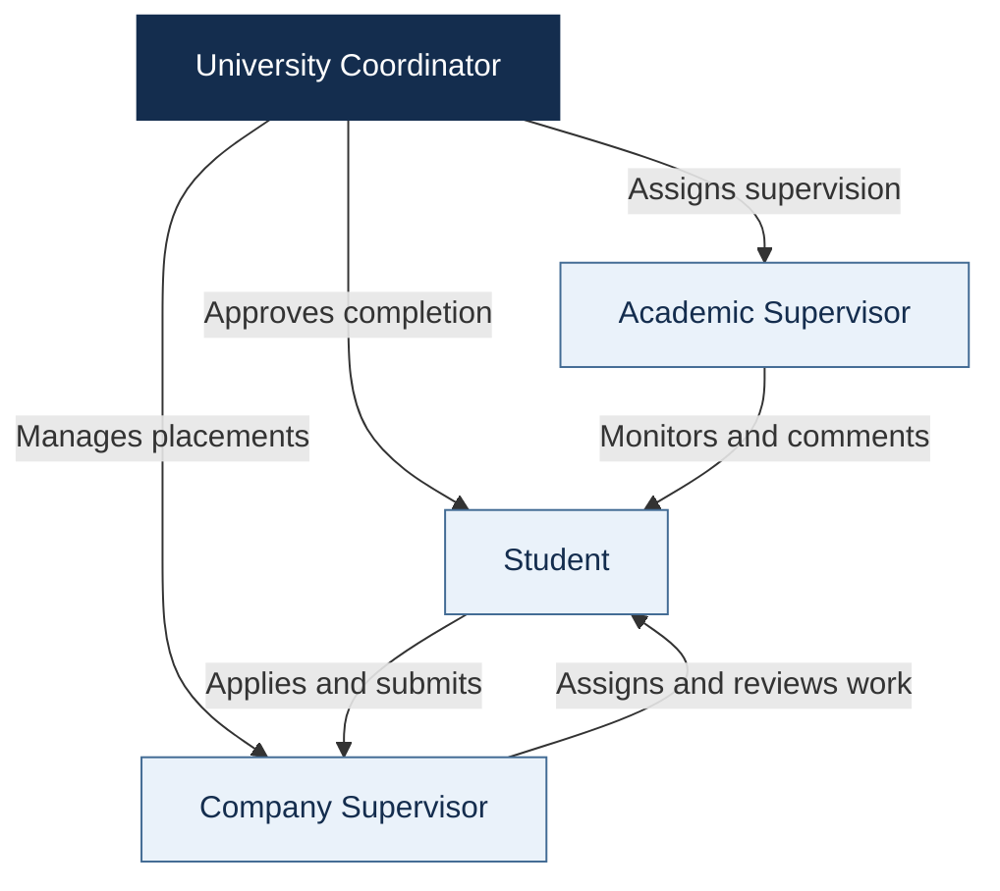
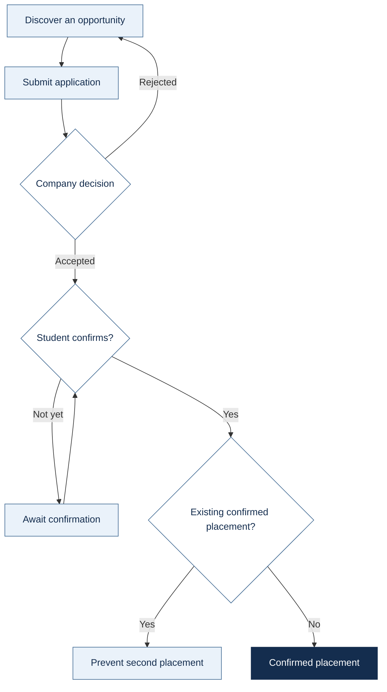
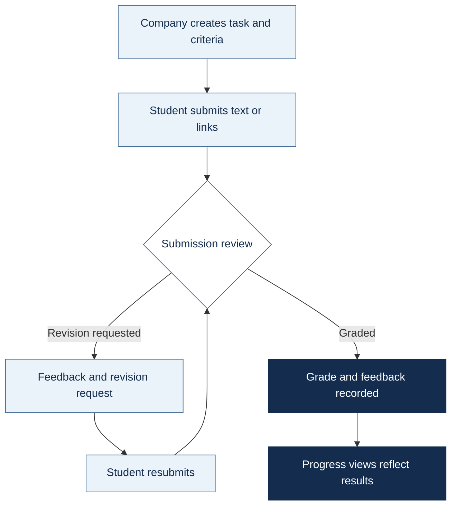
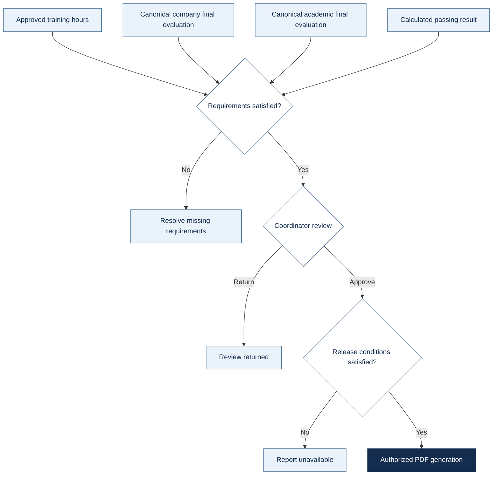
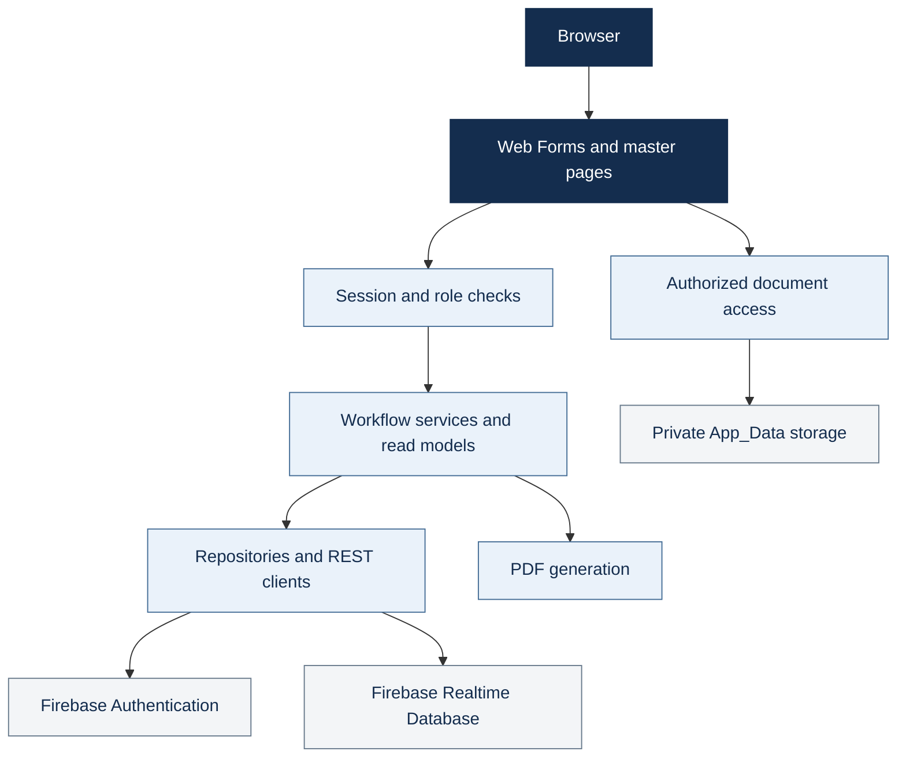

<h1>UIMS</h1>
<h3>University Internship Management System</h3>

<strong>One workspace. Four roles. A connected internship journey.</strong>

Discover · Apply · Train · Evaluate · Complete

<code>4 role portals</code> &nbsp; <code>English / العربية</code> &nbsp; <code>Light / Dark</code> &nbsp; <code>Responsive</code>

<a href="#at-a-glance">Overview</a> ·
<a href="#what-makes-uims-distinctive">Highlights</a> ·
<a href="#four-connected-portals">Portals</a> ·
<a href="#the-internship-journey">Workflow</a> ·
<a href="#run-locally">Quick start</a> ·
<a href="#delivery-status">Status</a>

Orange Academy · Group 4 · Academic team project

At a glance
UIMS connects internship recruitment, daily supervision, and completion review in one bilingual university platform.
University context	Experience	Application	Data
GJU School of Computing	Four dedicated portals	ASP.NET Web Forms / C#	Firebase Auth + Realtime Database
Academic project configuration	English/Arabic · LTR/RTL	.NET Framework 4.7.2	Private local student documents

[!IMPORTANT]
Core portals are implemented; training-hour page actions and canonical company-final integration remain outstanding. See Delivery status. Academic thresholds are provisional, not official GJU policy.

What makes UIMS distinctive
Experience	Project strength
A campus identity	Optional 3D campus story, university-gate login, and team lecture hall.
Connected recruitment	Discovery → application → company decision → student confirmation.
A visible feedback loop	Criteria-based tasks, submission history, grading, and revision requests.
Purposeful analytics	Role-scoped KPIs, interactive charts, detail views, and accessible data tables.
Bilingual workspaces	Local Noto fonts, saved language preference, and direction-aware layouts.
Consistent interaction	Shared responsive sidebar, themes, notifications, and account controls.
Controlled completion	Requirement checks, coordinator decisions, and authorized PDF release.
Progressive enhancement	Readable fallbacks for reduced motion and unavailable WebGL.

Four connected portals

Role	Main workspace	Key actions	Access boundary
Student	Opportunities · Applications · Tasks · Progress	Apply, confirm one offer, submit/resubmit, manage CV/portfolio.	Own records and eligible opportunities.
Company Supervisor	Recruitment · Trainees · Task reviews	Publish listings, decide applications, assign/grade work, record final evaluation.	Authorized company and trainee records.
Academic Supervisor	Assigned students · Academic evaluation	Monitor progress, comment, submit academic evaluation.	Assigned students/groups; no final completion approval.
Coordinator	Accounts · Groups · Placements · Completion	Assign supervision, manage access, review completion, release eligible reports.	Authorized administration; final completion authority.

<strong>Portal route reference</strong>

Paths are relative to the application root; listed filenames share the row's directory.
Directory	Pages
Pages/Student/	Dashboard.aspx, Profile.aspx, Opportunities.aspx, OpportunityDetails.aspx, Apply.aspx, MyApplications.aspx, MyTasks.aspx, Progress.aspx, StudentCVPortfolio.aspx
Pages/Company/	Dashboard.aspx, Opportunities.aspx, ManageOpportunities.aspx, ViewOpportunity.aspx, Applications.aspx, Trainees.aspx, TraineeDetails.aspx, Tasks.aspx, TaskReview.aspx, FinalEvaluation.aspx, Account.aspx
Pages/Academic/	Dashboard.aspx, StudentProgress.aspx, FinalEvaluation.aspx, Account.aspx
Pages/Coordinator/	Dashboard.aspx, ManageStudents.aspx, Students.aspx, Companies.aspx, AcademicSupervisors.aspx, Groups.aspx, ConfiguredGroups.aspx, Placements.aspx, PlacementDetails.aspx, CompletionReview.aspx, ContactMessages.aspx, Account.aspx

The internship journey
01 · Find and confirm a placement

Before recruitment	After confirmation
Coordinator prepares accounts/groups; company publishes opportunities.	Company assigns tasks; supervisors monitor progress.
Companies review submitted applications.	Conditional repository writes guard against a second confirmed placement.

02 · Submit, review, and improve

Submission	Review	Student visibility
Text and HTTP(S) links	Criteria, grades, feedback, revision requests	Attempt history, feedback, grades, and progress

03 · Review completion and release the report

Source default	Training hours	Task weight	Company final	Academic final	Pass
Provisional policy	160	30%	45%	25%	60%

[!NOTE]
Workflow diagrams show behavior and dependencies, including services awaiting page integration. Placement/student records may override required hours; scores normalize against recorded maxima. Confirm [university requirements](docs/01-university-rules.md) before institutional use.

Public experience and shared tools
Experience	What visitors or users see	Route
Home	Campus scroll story, public opportunity previews, internship steps.	Default.aspx
About / Contact	University/platform context; validated messages stored for the coordinator.	Pages/Public/About.aspx, Contact.aspx
Powered by / Journey	Team lecture hall; separate alternate Jisr campus experience.	Pages/Public/PoweredBy.aspx, Journey.aspx
Sign-in / Recovery	University-gate concept, reset requests, mandatory password changes.	Pages/Account/Login.aspx, ForgotPassword.aspx, ChangePassword.aspx
Notifications	View notifications and mark them read.	Pages/Account/Notifications.aspx
Meetings	Requests, responses, cancellation, filters, attendance/status, external Jitsi.	Pages/Meetings/MyMeetings.aspx
Completion reports	Authorized PDF output, including a certificate variant.	Pages/Account/CompletionReport.aspx
Error pages	Branded access-denied and page-not-found screens.	Pages/Public/AccessDenied.aspx, NotFound.aspx

Shared behavior	Implementation detail
Language	en-US / ar-JO; uims-lang preference; safe route/query retention and unsaved-input guard. User-entered records are not translated.
Theme	uims-theme; Light/Dark tokens; supported browsers use a 900 ms circular reveal.
Accessibility	Keyboard focus, readable labels, touch targets, accessible chart data, reduced-motion support.
Navigation	Expanded/compact desktop sidebar; mobile drawer.
Meeting access	Jordan time; joining opens 15 minutes before start and closes at scheduled end; allowlisted Jitsi links. Schedule.aspx redirects to the meeting workspace.
3D / network	Procedural artistic scenes, not surveyed digital twins. Maps, CDN assets, Firebase, and Jitsi require network availability.
Contact / notifications	Contact stores messages rather than sending email. Notification event coverage depends on workflow integration.

System architecture

Application	Interface	Persistence / identity	Visual layer
C# · Web Forms · .NET 4.7.2	HTML · CSS · plain JavaScript	Firebase REST repositories	Three.js r180
Public + four role masters	Bootstrap 5.3.3 + RTL	Realtime Database, not Firestore	GSAP / ScrollTrigger 3.13.0
Workflow services / read models	ASP.NET localization	Firebase Authentication	MapLibre + OpenFreeMap / OSM
In-project PDF generation	Local Noto Sans / Arabic	Private local uploads	Readable HTML fallbacks

No React, Next.js, Tailwind, or TypeScript build pipeline is required.

<strong>Data, documents, and security reference</strong>

Data area	Realtime Database nodes
Identity / organizations	users, companies, studentGroups
Recruitment	opportunities, publicOpportunityPreviews, applications
Work	placements, tasks, submissions, taskEvaluations
Results	companyFinalEvaluations, academicFinalEvaluations, academicComments, trainingHours, completions
Supporting features	notifications/{uid}, meetings, studentCvPortfolios, studentProfileExtras
Contact	Current ContactMessages; legacy contactMessages also supported by the inbox.

Convention / control	Rule
Record conventions	Case-sensitive node names; commonly PascalCase fields, integer enums, Unix-millisecond timestamps. Canonical placements use student UID keys.
Role IDs	Student 1 · Company 2 · Academic 3 · Coordinator 4.
Portal authorization	Firebase identity + matching trusted active UIMS profile; role-specific base classes recheck protected requests, including postbacks.
Session lifecycle	Expired/missing/deactivated profiles return to login; mandatory password changes enforced; protected responses disable caching; logout clears session.
Record authorization	Company, placement, student, and assignment checks; safe local login continuation.
Confidential evaluations	Authorized reviewers only; students receive results/reports released through completion.
Public previews	Dedicated public projection; populate it and deploy [appropriate rules](docs/public-opportunity-rules.fragment.json).
Private documents	App_Data/StudentDocuments/{studentId}/; authorized endpoints, including company applicant-document access.
Upload limits	CV PDF 5 MiB · Profile photo 2 MiB.
Storage operations	Keep private, writable, persistent, and backed up; exclude real records/uploads from commits. Generic StorageService.Upload is unimplemented; local uploads work separately.
Firebase rules	Required alongside server checks; validate every role and anonymous access.

Run locally
Required	Setup
Windows + Visual Studio	ASP.NET and web development workload.
.NET Framework 4.7.2	Targeting/developer pack + IIS Express.
NuGet	Restore CodeDom provider 2.0.1 and Newtonsoft.Json 13.0.4.
Firebase	Authentication + Realtime Database + matching active users profile.

Step	Action
1	Open InternshipManagementSystem/InternshipManagementSystem.sln.
2	Restore NuGet packages.
3	Configure Firebase app settings in the web project's Web.config.
4	Set InternshipManagementSystem as startup project.
5	Build and run with IIS Express; open the assigned URL.

<strong>CLI build, configuration, and deployment</strong>

Run from the repository root in Visual Studio Developer PowerShell; nuget requires the optional NuGet CLI.
nuget restore InternshipManagementSystem/InternshipManagementSystem.sln
msbuild InternshipManagementSystem/InternshipManagementSystem.sln /t:Build /p:Configuration=Debug
Configuration	Purpose / requirement
Firebase.DatabaseUrl	Environment-specific Realtime Database root.
Firebase.ApiKey	Authentication REST client API key.
Firebase.StorageBucket	Optional; generic upload remains unimplemented.
Active configuration	Inline Web.config app settings. Renaming App_Secrets.config.example alone does not configure the app.
Runtime	IIS with .NET Framework 4.7.2; dotnet run is not the startup command.
Deployment	HTTPS, environment settings, production error/debug review, role-tested Firebase rules.
Assets	Include fonts and adjacent Three.js modules; account for external Bootstrap, maps, Firebase, and Jitsi.
Private data	Preserve upload storage separately; exclude credentials, tokens, service accounts, fixtures, personal data, and local settings.

Delivery status
Area	Available	Outstanding
Portals / recruitment	Accounts, opportunities, applications, decisions, confirmation.	Environment/rules/data validation.
Tasks	Text/link submissions, history, grading, revisions.	General binary task attachments.
Training hours	Ledger/services; hour totals displayed.	Dedicated reporting/approval page actions.
Company final	Placement-based draft/submit UI.	Canonical companyFinalEvaluations writes for completion review.
Academic final	Canonical academic record.	Institutional grading validation.
Completion / PDFs	Gates, coordinator decisions, authorized generation.	Correct canonical evaluations and approved-hour records.
CV / profile files	Local uploads and authorized access.	Persistent deployment storage or an alternative.
Public previews	Projection and interface.	Populated projection + deployed rules.
Process video	Readable steps and conditional media.	Approved video/captions not bundled.
Academic policy	Centralized provisional defaults.	Confirm eligibility, hours, scales, weights, and pass threshold.

Verification and handover
Scenario	Representative browser scripts under tests/
Login / lifecycle	login-campus.browser.js, login-campus-lifecycle.browser.js
Navigation / theme	sidebar-unified.browser.js, coordinator-theme.browser.js
Recruitment	application.browser.js, application-decisions.browser.js, offer-confirmation.browser.js
Monitoring / analytics	coordinator-monitoring.browser.js, reference-analytics.browser.js, workspace-charts.browser.js
Localization	i18n-behaviour.browser.js, i18n-routes.browser.js

<strong>Run the isolated login/sidebar/theme scenarios</strong>

# Terminal 1: isolated simulation
postman simulation run postman/simulations/campus-login.sim.yaml --port 4912 --no-history --output ndjson

# Terminal 2: disposable application host
./tests/Start-LoginTestHost.ps1 -Port 58137 -SimulationPort 4912

# With playwright-cli installed
playwright-cli open http://localhost:58137/Pages/Account/Login.aspx
playwright-cli run-code --filename=tests/login-campus.browser.js
playwright-cli run-code --filename=tests/login-campus-lifecycle.browser.js
playwright-cli run-code --filename=tests/sidebar-unified.browser.js
playwright-cli run-code --filename=tests/coordinator-theme.browser.js
Scope	Limit
Host prerequisites	Restored packages, IIS Express, and valid local MSBuild paths. Inspect fixed ports/workstation paths.
Fixture isolation	Disposable copies and synthetic records only; never run against shared/production databases.
Evidence	Fixture behavior, not proof of live Firebase rules, production readiness, or universal browser support.
Outputs	Ignored local tests/artifacts/; no single portable npm test suite.

Project map
Location	Responsibility
InternshipManagementSystem/InternshipManagementSystem.sln	Main Visual Studio solution.
InternshipManagementSystem/InternshipManagementSystem/	Web application root.
Pages/ · Layout/ · Assets/	Routes, master pages, styles/scripts/fonts/3D assets.
Security/ · Services/ · Data/	Authorization, workflows/read models, repositories/REST.
Models/ · Common/	Domain records, enums, helpers, policy.
App_GlobalResources/ · App_Data/	English/Arabic resources; private application data.
docs/ · tests/ · postman/ · tools/	Guides, browser scenarios, simulations, development tooling.

Documentation and contribution
Topic	Guides
Domain / policy	[University rules](docs/01-university-rules.md) · [Data model](docs/02-data-model.md)
Setup	[Firebase](docs/05-firebase-setup.md) · [Windows](docs/08-run-on-windows.md)
Team workflow	[Ownership](docs/03-ownership.md) · [Git workflow](docs/04-git-workflow.md) · [Team guide](docs/06-team-guide.md)
Recruitment	[Applications](docs/06-application-form.md) · [Decisions](docs/07-application-decisions.md) · [Confirmation](docs/09-offer-confirmation-and-public-layout.md)
Monitoring / analytics	[Coordinator](docs/10-coordinator-monitoring.md) · [Charts](docs/32-approved-palette-charts.md) · [Analytics](docs/33-reference-analytics.md)
Interface	[Sidebar](docs/20-shared-sidebar.md) · [Themes](docs/32-theme-system.md) · [Localization](docs/34-localization.md) · [UI system](docs/27-shared-ui-system.md) · [Coverage](docs/30-workspace-redesign-coverage.md)
3D experiences	[Campus](docs/17-home-campus-experience.md) · [Login](docs/22-login-campus.md) · [Team hall](docs/23-powered-by-lecture-hall.md)

Contribution standard	Expectation
Focus	Scoped branches, CODEOWNERS, and a clearly identified role/user journey.
Preserve	Server authorization, localization, postbacks, safe navigation, unsaved-input protection.
Verify	Affected flows in both languages/themes and relevant mobile layouts.
Exclude	Personal data, uploads, fixture artifacts, and private local configuration.
Historical notes	Reconcile older feature notes with current source and this README.

Credits and licensing
Orange Academy · Group 4. Team responsibilities: [Ownership](docs/03-ownership.md). Team presentation: the application's Powered by page.

<strong>Third-party notices</strong>

Asset	Terms / reference
Three.js	MIT; [runtime provenance](InternshipManagementSystem/InternshipManagementSystem/Assets/js/vendor/README.md) and adjacent license.
GSAP / ScrollTrigger	Original notices and GSAP terms; not covered by Three.js MIT.
MapLibre GL JS / maps	BSD-3-Clause; provider and OpenStreetMap attribution retained.
Noto Sans / Arabic	SIL OFL 1.1; [font provenance](InternshipManagementSystem/InternshipManagementSystem/Assets/fonts/README.md). Historical Switzer assets use separate Fontshare terms.
Microsoft Rocketbox	[People-model licensing](InternshipManagementSystem/InternshipManagementSystem/Assets/models/people/LICENSE.md) and attribution notes.

No repository-wide license grant is declared. Third-party licenses do not license the entire application or university branding. Academic use of university identity does not imply official endorsement.

<strong>UIMS · Connecting opportunity with progress.</strong> 
Orange Academy · Group 4

<a href="#uims">Back to top ↑</a>

