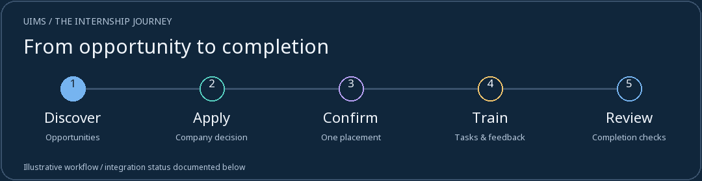
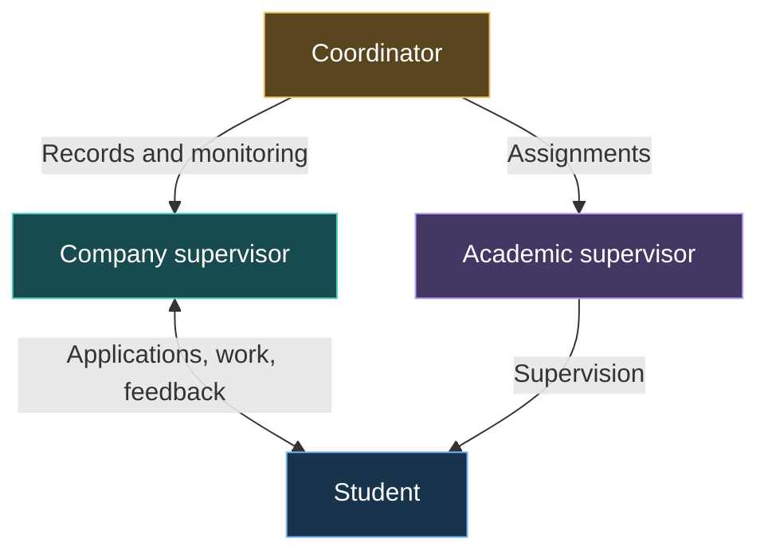
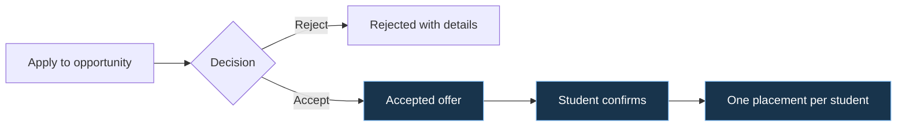
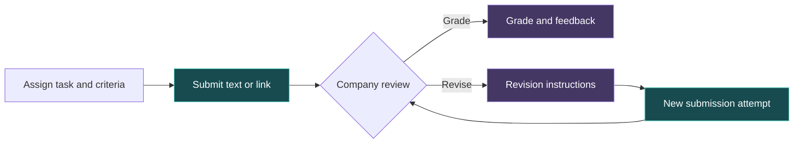
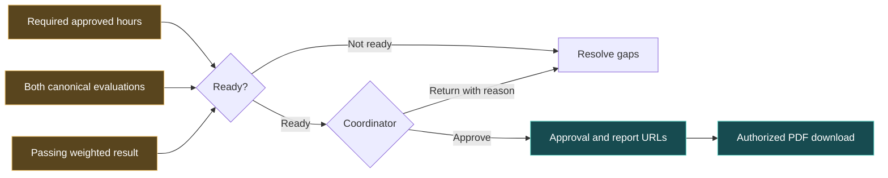
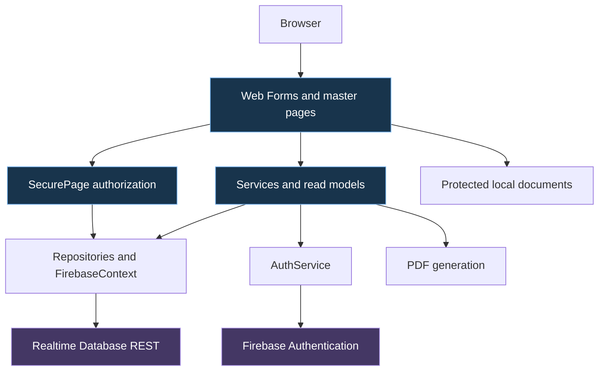

<div align="center">


# UIMS

### University Internship Management System

**From the first opportunity to the final review.**

A shared internship workspace for students, companies, and the university.


<br>



**[Explore](#overview) · [Roles](#roles) · [Workflows](#workflows) · [Setup](#setup) · [Status](#status) · [Reference](#reference) · [Team & Resources](#credits)**

<sub>Orange Academy · Group 4 · Academic team project · GJU School of Computing context</sub>

</div>

<a id="overview"></a>

## ✨ Built around the internship journey

**UIMS** connects recruitment, placement, task review, and academic oversight in an English/Arabic ASP.NET portal. Each role gets its own dashboard and permissions, within one university-focused interface.

| Opportunity → placement | Training → review | One consistent workspace |
| --- | --- | --- |
| Search, applications, company decisions, and confirmation of one accepted offer. | Task attempts, grades, feedback, revisions, progress, and completion checks. | Interactive analytics, shared sidebar, mobile navigation, Light/Dark themes, and RTL/LTR. |

| Public experience | Practical detail |
| --- | --- |
| University-inspired 3D | Campus story, security-gate login, team lecture hall; readable fallbacks. |
| Role-scoped dashboards | Animated KPIs, chart details, and accessible data views from authorized read models. |
| Shared coordination | Notifications, meeting requests with external Jitsi links, and a coordinator contact inbox. |

> **Implementation note:** the portal contains working workflows and pending integrations. Hour-entry/approval page actions and company-final synchronization still need wiring. [See the exact boundaries below.](#status)

<a id="roles"></a>

## 👥 Four roles, one coordinated workspace

| Role | Primary responsibility | Key tools |
| --- | --- | --- |
| 🎓 **Student** | Find a placement and complete assigned work. | Profile/CV, opportunities, applications, offer confirmation, submissions, progress. |
| 🏢 **Company Supervisor** | Recruit and supervise trainees. | Opportunity management, application decisions, tasks, grading, revisions, final-evaluation UI. |
| 📘 **Academic Supervisor** | Follow assigned students academically. | Assigned-student dashboard, progress, comments, canonical academic final evaluation. |
| 🧭 **University Coordinator** | Administer accounts and oversee placements. | Students/companies/supervisors, groups, placement monitoring, completion decisions, contact inbox. |



<a id="workflows"></a>

## 🔄 How the workflows connect

### 1 · Application decisions and one placement



Acceptance and confirmation are separate. Ownership checks and conditional writes protect the one-placement rule: an existing different placement blocks confirmation; retrying the same confirmed offer is supported.

### 2 · Task submission, feedback, and resubmission



Attempts and review history are retained. General binary task attachments are not implemented.

### 3 · Completion checks and report release



This is the implemented **completion-service contract**. The hour-entry UI and company-final integration do not yet supply all required records end to end. The gate uses approved-hour entries; completing a task does not automatically approve hours.

<a id="architecture"></a>

## 🏗️ Application architecture



| Layer | Technology |
| --- | --- |
| Web application | C#, ASP.NET Web Forms, **.NET Framework 4.7.2**; public + four role masters. |
| Interface | HTML, CSS, plain JavaScript, **Bootstrap 5.3.3** with RTL support. |
| Identity / data | Firebase Authentication / **Realtime Database**, both through REST; not Firestore. |
| Localization / fonts | ASP.NET resources (`en-US`, `ar-JO`); local Noto Sans / Noto Sans Arabic. |
| Selected visual experiences | **Three.js r180**, GSAP/ScrollTrigger **3.13.0**; lazy-loaded MapLibre campus map. |
| NuGet | CodeDom compiler provider **2.0.1**; Newtonsoft.Json **13.0.4**. |
| Files / reports | Private local profile/CV uploads; server-generated PDFs. |

No React, Tailwind, TypeScript, or Node build is needed to run the application.

<a id="setup"></a>

## 🚀 Run locally

| Prerequisite | Requirement |
| --- | --- |
| OS / IDE | Windows + Visual Studio with **ASP.NET and web development**. |
| Runtime / host | **.NET Framework 4.7.2 targeting pack** and IIS Express. |
| Services | Firebase Authentication + Realtime Database for your environment. |
| Dependencies | Restore both packages in `packages.config`. |

1. Open the [main Visual Studio solution](InternshipManagementSystem/InternshipManagementSystem.sln).
2. Restore NuGet packages and verify the web project's `Web.config` settings.
3. Set `InternshipManagementSystem` as the startup project; build and run with IIS Express.
4. Open the assigned local URL (`Default.aspx` is the default document).
5. Sign in with a Firebase identity and a matching active UIMS `users` profile.

From a Visual Studio Developer PowerShell at the repository root, after restore:

```powershell
msbuild InternshipManagementSystem/InternshipManagementSystem.sln /t:Build /p:Configuration=Debug
```

This is .NET Framework: `dotnet run` is not the startup command. [Configuration and troubleshooting](#configuration) are below.

<a id="status"></a>

## 🚦 Implementation status

| Area | Status | Exact boundary |
| --- | --- | --- |
| Recruitment and placement | **Implemented** | Opportunities, applications, company decisions, one-offer confirmation. |
| Task lifecycle | **Implemented** | Text/link attempts, grading, feedback, revisions; no general task-file upload. |
| Dashboards and shared UI | **Implemented** | Role-scoped analytics, sidebar, localization, themes, responsive layouts. |
| Academic final evaluation | **Implemented** | Writes the canonical academic evaluation record. |
| Training hours | **Partial integration** | Ledger/services and read views exist; dedicated reporting/approval page actions are pending. |
| Company final evaluation | **Partial integration** | UI writes legacy placement fields; must write canonical `companyFinalEvaluations` for completion review. |
| Completion / PDFs | **Implemented gate; dependencies pending** | Approval and authorized release require canonical evaluations and approved-hour entries. |
| Profile / CV files | **Local storage implemented** | PDF CV limit **5 MiB**, photo limit **2 MiB**; generic `StorageService.Upload` remains a placeholder. |
| Public opportunity previews | **Deployment dependent** | Requires populated public projections and appropriate deployed Firebase rules. |
| Home process video | **Asset pending** | Readable steps exist; approved video/caption set is not bundled. |
| Academic policy | **Provisional** | Hours, eligibility, scales, and grading must be institutionally verified. |

**Project defaults only:** 160 required hours; task/company/academic weights 30% / 45% / 25%; pass mark 60%. Placement/student records can override required hours. `GradingPolicy.cs` marks assumptions as hypothetical—**these are not official GJU regulations**. See [policy questions](docs/01-university-rules.md).

<a id="reference"></a>

## 📚 Technical reference

Expand the sections below for operational detail without leaving the showcase.

<a id="routes"></a>

<details>
<summary><strong>🗺️ Routes: public pages, shared tools, and all four portals</strong></summary>

| Experience | Purpose | Route |
| --- | --- | --- |
| Home | University introduction, campus scroll story, public opportunity previews, and internship process content. | `Default.aspx` |
| About | Platform and university context. | `Pages/Public/About.aspx` |
| Contact | Validate/store visitor messages for the coordinator inbox. | `Pages/Public/Contact.aspx` |
| Powered by | Team presentation through a lecture-hall experience with an HTML fallback. | `Pages/Public/PoweredBy.aspx` |
| Journey | Alternate Jisr campus experience; separate from the default homepage. | `Pages/Public/Journey.aspx` |
| Login | University security-gate and identity concept surrounding the sign-in form. | `Pages/Account/Login.aspx` |
| Password recovery | Firebase Authentication password-reset email request. | `Pages/Account/ForgotPassword.aspx` |
| Password change | Password updates, including mandatory temporary-password changes. | `Pages/Account/ChangePassword.aspx` |
| Error pages | Branded access-denied and page-not-found experiences. | `Pages/Public/AccessDenied.aspx`, `Pages/Public/NotFound.aspx` |

- **Notifications:** sidebar access and `Pages/Account/Notifications.aspx` support viewing and marking notifications as read. Services include notification hooks; event coverage depends on the workflow implementation.
- **Meetings:** `Pages/Meetings/MyMeetings.aspx` supports requests, responses, cancellation, filters, and status/attendance handling. Approved meetings use an allowlisted external Jitsi link. Joining opens 15 minutes before the scheduled start and closes at the scheduled end. Scheduling uses Jordan time. `Pages/Meetings/Schedule.aspx` redirects into this workspace.
- **Reports:** `Pages/Account/CompletionReport.aspx` generates PDF output for authorized students/coordinators after completion/release checks, including a certificate variant.

Contact stores messages rather than sending email. Video meetings use external Jitsi rather than a conferencing server hosted inside UIMS.

Paths below are relative to the web application root. Short filenames in a row share the preceding role directory. `Company` represents company supervisors; `Academic` represents academic supervisors.

### Student

The student portal focuses on finding a placement and understanding the next step.

| Area | Current capabilities | Main pages |
| --- | --- | --- |
| Dashboard | Internship journey, progress summaries, task information, and interactive analytics. | `Pages/Student/Dashboard.aspx` |
| Profile | Personal/academic information, skills, professional links, and supported profile documents. | `Pages/Student/Profile.aspx` |
| Opportunities | Search/filter listings, inspect details, and proceed to an application. | `Pages/Student/Opportunities.aspx`, `OpportunityDetails.aspx` |
| Applications | Submit a CV link and cover letter; follow decisions; confirm an accepted offer. | `Pages/Student/Apply.aspx`, `MyApplications.aspx` |
| Tasks | Submit text and HTTP(S) links, inspect attempt history, and resubmit after a revision request. | `Pages/Student/MyTasks.aspx` |
| Progress | View placement details, grades, criteria, feedback, recorded hours, and result/report availability. | `Pages/Student/Progress.aspx` |
| CV and portfolio | Manage a local PDF CV and portfolio links. | `Pages/Student/StudentCVPortfolio.aspx` |

Task submissions use text and links; a general binary task-attachment upload workflow is not implemented.

### Company Supervisor

The company portal connects recruitment with the trainee's day-to-day work.

| Area | Current capabilities | Main pages |
| --- | --- | --- |
| Dashboard | Company-scoped opportunity, applicant, trainee, and task summaries. | `Pages/Company/Dashboard.aspx` |
| Opportunities | Create opportunities; view, edit, and close existing listings. | `Pages/Company/Opportunities.aspx`, `ManageOpportunities.aspx`, `ViewOpportunity.aspx` |
| Applications | Review applicants and authorized documents; accept/reject applications with decision details. | `Pages/Company/Applications.aspx` |
| Trainees | Search trainees and inspect placement/task information. | `Pages/Company/Trainees.aspx`, `TraineeDetails.aspx` |
| Tasks | Create assignments with deadlines and review criteria. | `Pages/Company/Tasks.aspx` |
| Reviews | Grade submissions, provide feedback, and request revisions. | `Pages/Company/TaskReview.aspx` |
| Final evaluation | Save drafts and submit evaluation information through the current placement-based implementation. | `Pages/Company/FinalEvaluation.aspx` |
| Account | Maintain company and contact information. | `Pages/Company/Account.aspx` |

The company final-evaluation page has an integration gap with canonical completion records; see [Implementation status](#status).

### Academic Supervisor

The academic portal prioritizes oversight of assigned students.

| Area | Current capabilities | Main pages |
| --- | --- | --- |
| Dashboard | Assigned-student summaries, progress indicators, and review priorities. | `Pages/Academic/Dashboard.aspx` |
| Student progress | Inspect assigned placements, tasks, recorded hour totals, and academic comments. | `Pages/Academic/StudentProgress.aspx` |
| Final evaluation | Record the academic decision and comments; submitted evaluations become read-only. | `Pages/Academic/FinalEvaluation.aspx` |
| Account | Maintain personal information, profile photo, and password. | `Pages/Academic/Account.aspx` |

Access follows student/group assignments. Recorded-hour visibility exists; a complete page-based hour-entry and approval workflow is pending.

### University Coordinator

The coordinator portal provides administration and cross-placement monitoring.

| Area | Current capabilities | Main pages |
| --- | --- | --- |
| Dashboard | Operational summaries, review queues, and interactive analytics. | `Pages/Coordinator/Dashboard.aspx` |
| Students | Create/maintain student records, academic fields, and access status. | `Pages/Coordinator/ManageStudents.aspx`, `Students.aspx` |
| Companies | Maintain company records and company supervisor accounts. | `Pages/Coordinator/Companies.aspx` |
| Academic supervisors | Create, search, update, activate, and deactivate supervisor accounts. | `Pages/Coordinator/AcademicSupervisors.aspx` |
| Groups | Manage groups, membership, and academic-supervisor assignments. | `Pages/Coordinator/Groups.aspx`, `ConfiguredGroups.aspx` |
| Placements | Filter placements and inspect individual progress. | `Pages/Coordinator/Placements.aspx`, `PlacementDetails.aspx` |
| Completion review | Inspect requirements, approve/return reviews, and release eligible reports using canonical records. | `Pages/Coordinator/CompletionReview.aspx` |
| Contact inbox | Read, search, and mark website messages as reviewed. | `Pages/Coordinator/ContactMessages.aspx` |
| Account | Manage personal information and password. | `Pages/Coordinator/Account.aspx` |

</details>

<a id="experience"></a>

<details>
<summary><strong>🎨 Themes, localization, accessibility, and 3D fallbacks</strong></summary>

### A consistent workspace

All four portals share a sidebar containing navigation, page context, language/theme controls, notifications, and account access. Desktop supports expanded/compact states; mobile uses a drawer. Its scrollbar is visually hidden while scrolling remains available.

The approved navy, pale blue, white, and neutral palette has dedicated Dark theme tokens. **Noto Sans** and **Noto Sans Arabic** are served locally for consistent bilingual typography.

Dashboard charts/KPIs provide interactive details and accessible data views. Date-based activity charts can filter supported periods; categorical snapshots remain snapshots rather than fabricated historical trends. Values come from role-scoped read models.

### Language and direction

- ASP.NET resources and server culture handling provide English (`en-US`) and Arabic (`ar-JO`).
- Compact `EN` / `AR` controls reuse existing localization/navigation behavior.
- A `uims-lang` cookie saves preference; layouts switch between LTR and RTL.
- Language switching retains the route and supported safe query parameters and uses the existing unsaved-input guard.
- Changing interface language does not translate user-entered database records.

### Themes and purposeful motion

- Explicit Light/Dark choices use the existing `uims-theme` preference.
- Supported browsers show a 900 ms circular theme reveal originating from the control.
- Dashboard entrances, animated numbers, chart motion, and button feedback use CSS/plain JavaScript.
- Reduced-motion settings simplify/disable movement; unsupported animation APIs fall back to a functional state change.
- Shared controls include keyboard focus, readable labels, touch targets, and responsive layouts.

### 3D and progressive enhancement

Selected public pages load Three.js asynchronously: Home's campus story, Login's university gate/security concept, Powered by's team lecture hall, and the alternate Journey experience.

These are artistic, procedural interpretations, not a surveyed digital twin or photogrammetric reconstruction. Readable content and fallback visuals support reduced-motion and non-WebGL use. External maps, meetings, and CDN resources still depend on network availability.

</details>

<a id="security"></a>

<details>
<summary><strong>🔐 Authorization, database conventions, and private documents</strong></summary>

Sign-in authenticates with Firebase, then loads the UIMS database profile and trusted role. A Firebase identity alone does not grant portal access.

Protected pages inherit role-specific base classes. On protected requests, including postbacks, shared security rechecks the database profile, active status, mandatory password changes, and role. Missing/deactivated profiles and expired authentication return to sign-in. Protected responses disable caching; logout clears the session.

Workflows add placement, company, student, and assignment checks. Company/academic evaluation forms remain confidential to authorized reviewers; students receive the result/report released by the completion workflow. Login only supports safe local continuation, including the student application route, rather than arbitrary external redirects.

Application checks do not replace Firebase rules. Development configuration and database rules require production review for authenticated access, ownership, public projections, and environment settings.

### Database areas

| Area | Realtime Database nodes |
| --- | --- |
| Identity/organizations | `users`, `companies`, `studentGroups` |
| Recruitment | `opportunities`, `publicOpportunityPreviews`, `applications` |
| Internship work | `placements`, `tasks`, `submissions`, `taskEvaluations` |
| Supervision/results | `companyFinalEvaluations`, `academicFinalEvaluations`, `academicComments`, `trainingHours`, `completions` |
| Supporting features | `notifications/{uid}`, `meetings`, `studentCvPortfolios`, `studentProfileExtras` |
| Contact messages | Current submissions use `ContactMessages`; coordinator support also handles legacy `contactMessages`. |

Names are case-sensitive. Models commonly use PascalCase fields, integer enums, and Unix-millisecond timestamps. Canonical placements are keyed by student UID. Role IDs are Student `1`, Company Supervisor `2`, Academic Supervisor `3`, Coordinator `4`.

Anonymous opportunity previews use a dedicated public projection rather than private application records. Availability depends on populated projections and deployed rules; see the [public rules fragment](docs/public-opportunity-rules.fragment.json).

### Private student files

Active profile/CV pages store local uploads under:

```text
InternshipManagementSystem/InternshipManagementSystem/App_Data/StudentDocuments/{studentId}/
```

CV PDFs have a **5 MiB** upload limit; profile photos have a **2 MiB** limit. Authorized pages serve documents after access checks, including the company applicant-document endpoint.

Keep storage private, writable by the application, persistent across deployment, and backed up separately. **Do not commit student documents or real personal records.** Do not assume `.gitignore` excludes every upload path.

The generic `StorageService.Upload` is unimplemented. Working local profile/CV uploads are separate; an empty Firebase Storage setting does not disable them.

</details>

<a id="configuration"></a>

<details>
<summary><strong>⚙️ Configuration, deployment, and troubleshooting</strong></summary>

| `Web.config` key | Purpose |
| --- | --- |
| `Firebase.DatabaseUrl` | Realtime Database root for the environment. |
| `Firebase.ApiKey` | Firebase client API key used by Authentication REST. |
| `Firebase.StorageBucket` | Optional storage setting; generic upload remains unimplemented. |

The active configuration uses inline app settings. `App_Secrets.config.example` does **not** automatically supply settings; copying/renaming it alone will not configure the application.

For deployment, publish to IIS supporting .NET Framework 4.7.2, configure HTTPS and environment-specific settings, and review production error/debug behavior. Development configuration is not a production hardening template. Validate Firebase rules under every role and anonymous access; preserve private upload storage independently of binaries.

Include required fonts/assets and adjacent Three.js module files. Account for external Bootstrap delivery, map tiles, Firebase, and Jitsi. Exclude development fixtures, private credentials, tokens, service-account files, real personal data, and local deployment settings. Confirm academic policy and finish outstanding workflow integration before relying on completion decisions operationally.

### Troubleshooting

| Symptom | Check |
| --- | --- |
| Missing references/compiler provider | Restore packages; verify the targeting pack and web workload. |
| Login succeeds but portal access fails | Check matching UID, role, `IsActive`, password-change state, and Firebase rules. |
| Empty public opportunity previews | Check eligible/published data, the projection, and deployed public rules. |
| Upload fails | Check type/size and write permissions on private document storage. |
| Static 3D fallback appears | Check WebGL, reduced motion, asset delivery, and browser console. |
| Main updates appear absent | Confirm checkout/branch and IIS Express project path; rebuild/reload. |
| Visual Studio reports external project-file changes | Preserve unsaved IDE changes, then reconcile/reload the disk version; overwriting may discard external changes. |

If the optional NuGet CLI is installed, restore with:

```powershell
nuget restore InternshipManagementSystem/InternshipManagementSystem.sln
```

</details>

<a id="testing"></a>

<details>
<summary><strong>🧪 Testing: isolated fixtures, browser scenarios, and limitations</strong></summary>

Scenario-based browser scripts and disposable hosts cover public pages, localization, applications, offer confirmation, monitoring, analytics, sidebars, login lifecycle, and themes.

| Area | Representative files |
| --- | --- |
| Login | `tests/login-campus.browser.js`, `tests/login-campus-lifecycle.browser.js` |
| Shared sidebar | `tests/sidebar-unified.browser.js` |
| Coordinator theme reveal | `tests/coordinator-theme.browser.js` |
| Recruitment | `tests/application.browser.js`, `tests/application-decisions.browser.js`, `tests/offer-confirmation.browser.js` |
| Monitoring | `tests/coordinator-monitoring.browser.js` |
| Analytics | `tests/reference-analytics.browser.js`, `tests/workspace-charts.browser.js` |
| Localization | `tests/i18n-behaviour.browser.js`, `tests/i18n-routes.browser.js` |
| Fixture infrastructure | `tests/Start-LoginTestHost.ps1`, `postman/simulations/campus-login.sim.yaml` |

These are not one portable `npm test` suite. Some scripts contain workstation paths/fixed ports; inspect and adjust MSBuild, host, simulation, and artifact paths before reuse. For the login/sidebar/theme setup, an example sequence is:

```powershell
# Terminal 1: isolated HTTP simulation
postman simulation run postman/simulations/campus-login.sim.yaml --port 4912 --no-history --output ndjson

# Terminal 2: disposable application copy
./tests/Start-LoginTestHost.ps1 -Port 58137 -SimulationPort 4912

# With playwright-cli installed
playwright-cli open http://localhost:58137/Pages/Account/Login.aspx
playwright-cli run-code --filename=tests/login-campus.browser.js
playwright-cli run-code --filename=tests/login-campus-lifecycle.browser.js
playwright-cli run-code --filename=tests/sidebar-unified.browser.js
playwright-cli run-code --filename=tests/coordinator-theme.browser.js
```

Host scripts require restored packages, IIS Express, and an appropriate local MSBuild path. They change a disposable copy; fixture scripts may write/reset synthetic records. **Use an isolated simulation, never a university/shared production database.**

Simulation checks establish fixture behavior, not live Firebase rule correctness, production readiness, or universal browser support. Generated `tests/artifacts/` screenshots/recordings are ignored local output.

</details>

<a id="documentation"></a>

<details>
<summary><strong>📖 Documentation map and contribution guide</strong></summary>

| Topic | References |
| --- | --- |
| Policy and domain | [University rules](docs/01-university-rules.md), [Data model](docs/02-data-model.md) |
| Collaboration | [Ownership](docs/03-ownership.md), [Git workflow](docs/04-git-workflow.md), [Team guide](docs/06-team-guide.md) |
| Environment | [Firebase background](docs/05-firebase-setup.md), [Windows setup](docs/08-run-on-windows.md) |
| Recruitment | [Application form](docs/06-application-form.md), [Decisions](docs/07-application-decisions.md), [Offer confirmation](docs/09-offer-confirmation-and-public-layout.md) |
| Monitoring | [Coordinator monitoring](docs/10-coordinator-monitoring.md) |
| Shared controls | [Sidebar](docs/20-shared-sidebar.md), [Themes](docs/32-theme-system.md), [Localization](docs/34-localization.md) |
| Analytics | [Palette/charts](docs/32-approved-palette-charts.md), [Reference analytics](docs/33-reference-analytics.md) |
| Visual experiences | [Campus](docs/17-home-campus-experience.md), [Login](docs/22-login-campus.md), [Team hall](docs/23-powered-by-lecture-hall.md) |
| Shared interface | [UI system](docs/27-shared-ui-system.md), [Workspace coverage](docs/30-workspace-redesign-coverage.md) |

Feature notes capture different development stages and may contain historical instructions/screenshots. Reconcile them with this README and current source.

Contribute through focused branches and respect [CODEOWNERS](.github/CODEOWNERS) and the team workflow. Explain the affected role/user journey. Preserve server authorization, localization, postbacks, safe navigation, and unsaved-input protection. Check affected UI in both languages/themes and mobile layouts when relevant. Exclude personal records, uploads, fixture output, and private local configuration from commits.

**Source map:** `Pages/` + `Layout/` compose the UI; `Security/` protects requests; `Services/` implements workflows/read models; `Data/` handles repositories/REST; `Models/` defines records; `Common/` holds policy/helpers; `App_GlobalResources/` contains translations; `Assets/` holds client files. All are under `InternshipManagementSystem/InternshipManagementSystem/`.

</details>

<a id="credits"></a>

## 🤝 Team, project resources, and licensing

UIMS is an **Orange Academy Group 4** team project. The application's **Powered by** page presents the team, and the [Ownership guide](docs/03-ownership.md) contains additional development responsibilities.

### 👥 Project team

| Team member | Project role |
| --- | --- |
| **Ahmad Bani Hamad** | Scrum Master |
| **سارة الدولات** | Quality Assurance (QA) |
| **سارة رجوب** | Product Owner |
| **ندى علاونة** | Team Member |
| **سجى** | Team Member |
| **اسامة بني هاني** | Team Member |
| **فاطمة** | Team Member |

### 🎨 Design and task management

| Resource | Description | Link |
| --- | --- | --- |
| **Figma** | UIMS — GJU Homepage Mockup | [View Figma design](https://www.figma.com/design/5vZ9vUap9JGFjevOlmBZVi/UIMS-%E2%80%94-GJU-Homepage-Mockup?t=MHVxvLg0UOMWCpRn-0) |
| **Trello** | Internship System — Group 4 board | [Open Trello board](https://trello.com/b/fUVGTBxk/internship-system-group4) |

### Third-party assets and licensing

Third-party assets retain their terms:

- **Three.js:** MIT; see [runtime provenance](InternshipManagementSystem/InternshipManagementSystem/Assets/js/vendor/README.md) and the adjacent license.
- **GSAP/ScrollTrigger:** original notices and GSAP terms apply; Three.js's MIT license does not cover them.
- **MapLibre GL JS:** BSD-3-Clause; map tiles/data retain provider and OpenStreetMap attribution.
- **Noto Sans/Noto Sans Arabic:** SIL Open Font License 1.1; see [font provenance](InternshipManagementSystem/InternshipManagementSystem/Assets/fonts/README.md). Historical Switzer assets have separate Fontshare terms.
- **Microsoft Rocketbox assets:** see [people-model licensing](InternshipManagementSystem/InternshipManagementSystem/Assets/models/people/LICENSE.md) and attribution notes.

No repository-wide license grant is declared here. Third-party terms do not automatically license the entire application or university branding. University identity provides project context and does not imply official endorsement.

The [journey banner](docs/assets/uims-journey.gif) is an original conceptual illustration, not an application screenshot. [Asset notes and regeneration](docs/assets/README.md) describe its source and motion limitations.


## Integrated workflow guides

- [Team integration and evaluation routes](docs/12-team-integration.md)
- [Ahmad workflow and setup notes](docs/13-ahmad-workflow-notes.md)
- [Excel exports](docs/09-excel-exports.md)
- [Email and in-app notifications](docs/10-email-notifications.md)
- [Evidence-based completion review](docs/11-completion-review.md)
