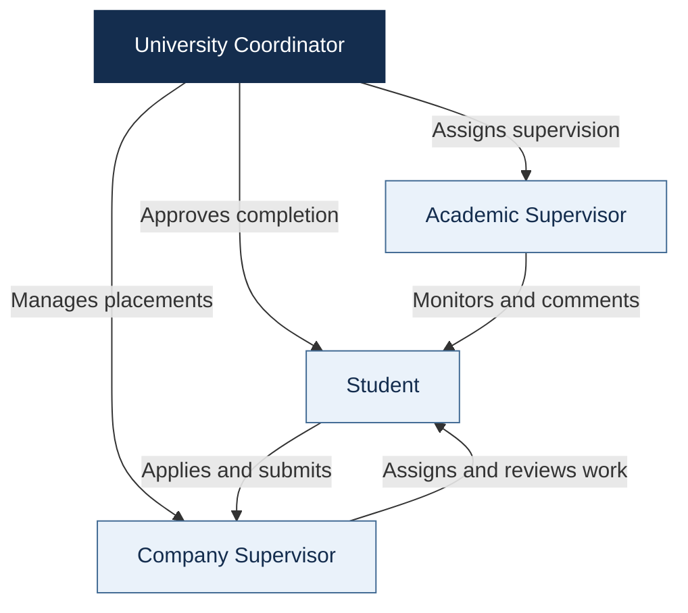
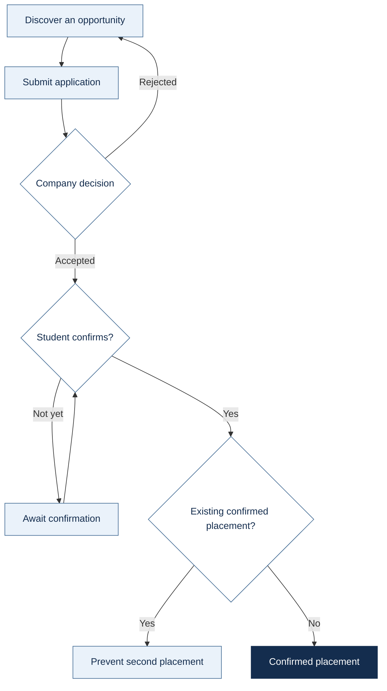
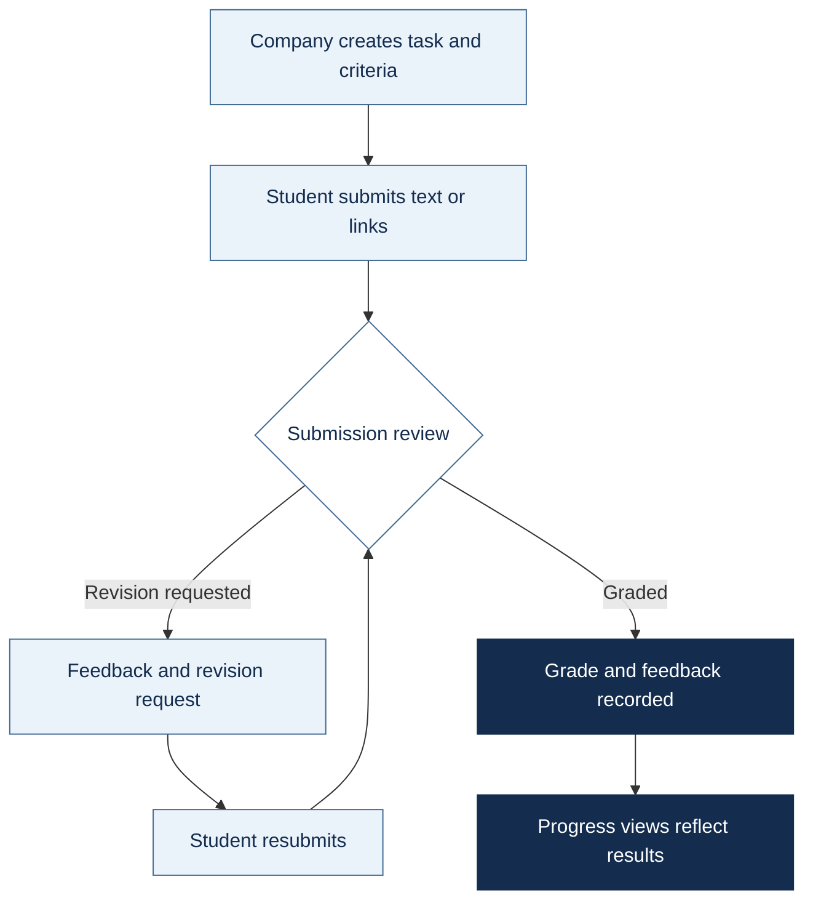
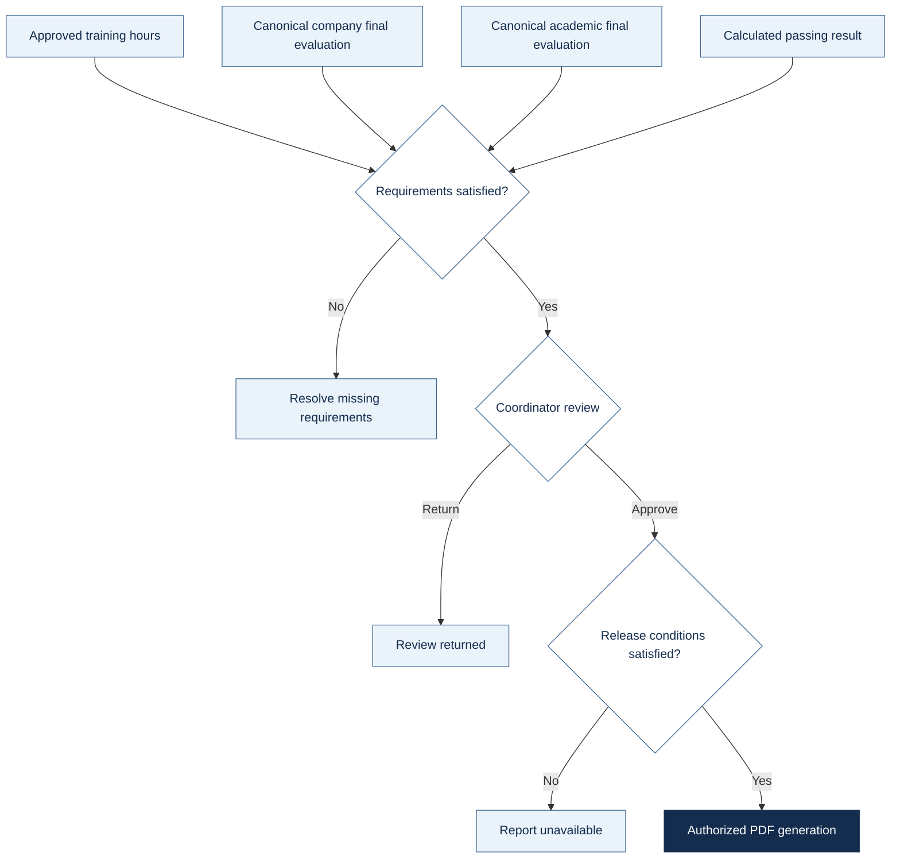
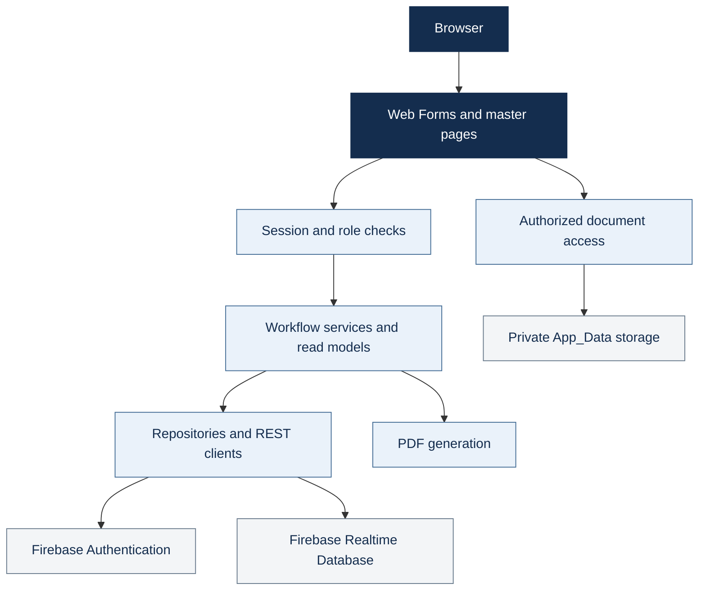

<h1>UIMS</h1>
<h3>University Internship Management System</h3>

<strong>UIMS · One workspace for the university internship journey</strong>

Discover opportunities. Coordinate placements. Review work. Follow progress.

  
  
  
  

<strong>Student</strong> &nbsp;·&nbsp; <strong>Company Supervisor</strong> &nbsp;·&nbsp; <strong>Academic Supervisor</strong> &nbsp;·&nbsp; <strong>University Coordinator</strong>

  <a href="#overview">Explore UIMS</a> &nbsp;·&nbsp;
  <a href="#role-portals">Role portals</a> &nbsp;·&nbsp;
  <a href="#getting-started">Run locally</a> &nbsp;·&nbsp;
  <a href="#implementation-status">Implementation status</a> &nbsp;·&nbsp;
  <a href="#documentation">Documentation</a>

<code>4 role portals</code> &nbsp; <code>EN / AR</code> &nbsp; <code>Light / Dark</code> &nbsp; <code>Responsive UI</code>

Orange Academy · Group 4 · Academic team project

Overview
From the first application to the final completion report.

UIMS brings internship recruitment, supervision, and administration into one bilingual website. Students find opportunities and follow their work, companies recruit and supervise trainees, academic supervisors monitor assigned students, and university coordinators manage accounts, placements, and completion decisions.

The experience combines role-specific dashboards with English/Arabic layouts, Light/Dark themes, and optional 3D campus storytelling. Its current academic configuration targets the German Jordanian University School of Computing.
For students	For supervisors	For coordinators
Find a placement and understand the next step.	Review work and follow student progress.	Coordinate supervision and completion decisions.

[!IMPORTANT]
This documentation describes the current academic implementation. Some workflow services still need page-level integration; review Implementation status before an end-to-end demonstration or deployment. Academic thresholds are provisional project defaults, not verified GJU regulations.

<strong>Browse all sections</strong>

- Platform highlights
- Role portals
- Internship workflow
- Public website and shared features
- Design, accessibility, and localization
- Architecture and technology
- Data and document handling
- Authentication and authorization
- Getting started
- Configuration and deployment
- Verification
- Implementation status
- Repository structure
- Documentation
- Contributing
- Credits and licensing

Platform highlights
Capability	What it enables
Four connected workspaces	Dedicated dashboards, navigation, permissions, and operational pages for each role.
A connected application journey	Opportunity discovery, applications, company decisions, and confirmation of an accepted offer.
Structured task review	Assignments, submission attempts, criteria, grading, feedback, and revision requests.
Progress visibility	Placement details, tasks, recorded hours, evaluations, and completion review.
Interactive analytics	Role-scoped KPIs, chart interactions, accessible data views, and detail panels.
Bilingual by design	English/Arabic resources, LTR/RTL layouts, and a saved language preference.
Shared workspace controls	Responsive sidebar, themes, notifications, and account access.
University-inspired experiences	Campus storytelling, security-gate login, and a team lecture hall with readable fallbacks.

Role portals
Each role has its own workspace while sharing the same internship records and authorization infrastructure.
Collaboration model

Authority: academic supervisors oversee assigned students; the coordinator makes the final completion decision. Arrows describe responsibilities, not unrestricted data access.
Portal	Primary focus	Entry point
Student	Opportunities, applications, tasks, and progress.	Pages/Student/Dashboard.aspx
Company Supervisor	Recruitment, trainees, assignments, and reviews.	Pages/Company/Dashboard.aspx
Academic Supervisor	Assigned students, academic comments, and evaluation.	Pages/Academic/Dashboard.aspx
University Coordinator	Accounts, supervision, placements, and completion.	Pages/Coordinator/Dashboard.aspx

Paths below are relative to the web application root. Short filenames share the preceding role directory. Company and Academic represent their respective supervisor roles.

<strong>01 · Student — discover, apply, and progress</strong>

Area	Current capabilities	Pages
Dashboard	Internship journey, progress summaries, task information, and analytics.	Pages/Student/Dashboard.aspx
Profile	Personal/academic details, skills, professional links, and supported documents.	Pages/Student/Profile.aspx
Opportunities	Search/filter listings, inspect details, and start an application.	Pages/Student/Opportunities.aspx, OpportunityDetails.aspx
Applications	Submit a CV link and cover letter, follow decisions, and confirm an accepted offer.	Pages/Student/Apply.aspx, MyApplications.aspx
Tasks	Submit text and HTTP(S) links, view attempts, and resubmit after revision requests.	Pages/Student/MyTasks.aspx
Progress	Placement details, grades, criteria, feedback, hours, and result/report availability.	Pages/Student/Progress.aspx
CV and portfolio	Manage a local PDF CV and portfolio links.	Pages/Student/StudentCVPortfolio.aspx

Submission scope: tasks support text and links. General binary task-attachment uploads are not implemented.

<strong>02 · Company Supervisor — recruit, assign, and review</strong>

Area	Current capabilities	Pages
Dashboard	Company-scoped opportunity, applicant, trainee, and task summaries.	Pages/Company/Dashboard.aspx
Opportunities	Create, view, edit, and close listings.	Pages/Company/Opportunities.aspx, ManageOpportunities.aspx, ViewOpportunity.aspx
Applications	Review applicants and authorized documents; accept/reject with decision details.	Pages/Company/Applications.aspx
Trainees	Search trainees and inspect placement/task information.	Pages/Company/Trainees.aspx, TraineeDetails.aspx
Tasks	Create assignments with deadlines and review criteria.	Pages/Company/Tasks.aspx
Reviews	Grade submissions, provide feedback, and request revisions.	Pages/Company/TaskReview.aspx
Final evaluation	Save drafts and submit through the current placement-based implementation.	Pages/Company/FinalEvaluation.aspx
Account	Maintain company and contact details.	Pages/Company/Account.aspx

Integration dependency: the final-evaluation page needs canonical completion-record integration; see Implementation status.

<strong>03 · Academic Supervisor — monitor, guide, and evaluate</strong>

Area	Current capabilities	Pages
Dashboard	Assigned-student summaries, progress indicators, and review priorities.	Pages/Academic/Dashboard.aspx
Student progress	Assigned placements, tasks, recorded hour totals, and academic comments.	Pages/Academic/StudentProgress.aspx
Final evaluation	Record the academic decision/comments; submitted evaluations become read-only.	Pages/Academic/FinalEvaluation.aspx
Account	Maintain personal details, profile photo, and password.	Pages/Academic/Account.aspx

Access follows student/group assignments. Hour totals are visible; a complete page-based hour-entry and approval workflow is pending.

<strong>04 · University Coordinator — organize, oversee, and approve</strong>

Area	Current capabilities	Pages
Dashboard	Operational summaries, review queues, and analytics.	Pages/Coordinator/Dashboard.aspx
Students	Create/maintain student records, academic fields, and access status.	Pages/Coordinator/ManageStudents.aspx, Students.aspx
Companies	Maintain company records and supervisor accounts.	Pages/Coordinator/Companies.aspx
Academic supervisors	Create, search, update, activate, and deactivate accounts.	Pages/Coordinator/AcademicSupervisors.aspx
Groups	Manage membership and academic-supervisor assignments.	Pages/Coordinator/Groups.aspx, ConfiguredGroups.aspx
Placements	Filter placements and inspect individual progress.	Pages/Coordinator/Placements.aspx, PlacementDetails.aspx
Completion	Inspect requirements, approve/return reviews, and release eligible reports using canonical records.	Pages/Coordinator/CompletionReview.aspx
Contact inbox	Read, search, and mark messages as reviewed.	Pages/Coordinator/ContactMessages.aspx
Account	Manage personal details and password.	Pages/Coordinator/Account.aspx

Internship workflow
Recruitment and placement

Operational stages
Stage	Owner	Outcome
01 · Prepare	Coordinator	Accounts, companies, groups, and supervision assignments.
02 · Publish	Company supervisor	Available internship opportunities.
03 · Apply and decide	Student + company	Applications and recruitment decisions.
04 · Confirm	Student	One confirmed placement; conditional repository writes guard against a second.
05 · Work and review	Student + company	Tasks, submissions, grades, feedback, and revisions.
06 · Monitor	Authorized roles	Progress information scoped to permissions and assignments.
07 · Review completion	Coordinator	Decision after approved hours, both canonical final evaluations, and passing-result checks.
08 · Release	Student or coordinator	Authorized PDF generation after release conditions are satisfied.

[!NOTE]
Hour reporting/approval and company-final integration still require the work listed below. The completion screen depends on correctly supplied canonical records from preceding workflows.

Task submission and review

Completion and report release

These diagrams describe workflow behavior and dependencies; hour reporting/approval page actions and canonical company-final writes still need integration. See Implementation status for the implementation boundary.
Provisional evaluation policy
Required hours	Task component	Company final	Academic final	Passing threshold
160	30%	45%	25%	60%

Placement/student records may override the required-hour default. Stored evaluations are normalized against their recorded maximum scores.

Common/GradingPolicy.cs identifies these assumptions as hypothetical and awaiting confirmation. Validate [University rules](docs/01-university-rules.md) and institutional requirements before use; these are not official GJU policy.
Public website and shared features

<strong>Public routes and account pages</strong>

Experience	Purpose	Route
Home	University introduction, campus scroll story, opportunity previews, and internship process content.	Default.aspx
About	University and platform context.	Pages/Public/About.aspx
Contact	Validate/store messages for the coordinator inbox.	Pages/Public/Contact.aspx
Powered by	Team lecture hall with an HTML fallback.	Pages/Public/PoweredBy.aspx
Journey	Alternate Jisr campus experience, separate from Home.	Pages/Public/Journey.aspx
Login	Security-gate and identity concept around sign-in.	Pages/Account/Login.aspx
Password recovery	Request a Firebase Authentication reset email.	Pages/Account/ForgotPassword.aspx
Password change	Update passwords, including mandatory temporary-password changes.	Pages/Account/ChangePassword.aspx
Error pages	Branded access-denied and page-not-found experiences.	Pages/Public/AccessDenied.aspx, Pages/Public/NotFound.aspx

Shared feature	Behavior
Notifications	Sidebar access and Pages/Account/Notifications.aspx support viewing/marking messages as read. Services include hooks; event coverage depends on workflow implementation.
Meetings	Pages/Meetings/MyMeetings.aspx handles requests, responses, cancellation, filters, and status/attendance. Approved meetings use an allowlisted external Jitsi link. Joining opens 15 minutes before start and closes at the scheduled end, using Jordan time. Schedule.aspx redirects here.
Reports	Pages/Account/CompletionReport.aspx generates authorized PDFs after completion/release checks, including a certificate variant.

The Contact page stores messages; it does not send email. Meetings use external Jitsi rather than a conferencing server hosted within UIMS.
Design, accessibility, and localization
Foundation	Experience
Consistent navigation	Shared sidebar with page context, language/theme controls, notifications, and account access. Expanded/compact desktop states and a mobile drawer. The scrollbar is visually hidden while scrolling remains available.
University identity	Navy, pale blue, white, and neutrals with dedicated Dark theme tokens. Locally served Noto Sans and Noto Sans Arabic.
English / العربية	ASP.NET resources support en-US and ar-JO, saved with uims-lang; layouts switch LTR/RTL. Compact EN/AR controls preserve routes, supported safe query parameters, and the unsaved-input guard. Database text is not automatically translated.
Light / Dark	Explicit choices persist through uims-theme. Supported browsers show a 900 ms circular reveal from the control; unsupported APIs fall back to a functional change.
Purposeful motion	CSS/plain JavaScript entrances, animated numbers, charts, and button feedback. Reduced-motion preferences simplify or disable movement.
Accessible interaction	Keyboard focus, readable labels, touch targets, responsive layouts, and accessible chart data views.
Honest analytics	Role-scoped read models supply values. Supported date charts filter periods; categorical snapshots remain snapshots.

A campus experience with progressive enhancement
Selected public pages asynchronously load Three.js: Home for the campus story, Login for the university gate, Powered by for the team lecture hall, and Journey for the alternate campus experience.

These are artistic procedural interpretations, not surveyed digital twins or photogrammetric reconstructions. Readable content and fallback visuals support reduced-motion and non-WebGL use. Maps, meetings, and CDN resources depend on network availability.
Architecture and technology
The application separates page composition, access checks, workflow logic, and persistence. Private uploads stay on the application host; identity and structured records use Firebase.

Diagram key: navy = entry and composition · pale blue = application behavior · gray = storage and external identity.

<strong>Technology reference</strong>

Layer	Implementation
Application	C#, ASP.NET Web Forms, .NET Framework 4.7.2.
Composition	Public master page and Student, Company, Academic, Coordinator masters.
Frontend	HTML, CSS, plain JavaScript, Bootstrap 5.3.3 with RTL support.
Localization	ASP.NET global resources, culture selection, direction-aware layouts.
Identity	Firebase Authentication through REST.
Persistence	Firebase Realtime Database REST repositories; not Cloud Firestore.
HTTP / JSON	.NET HTTP APIs, shared JSON helpers, Newtonsoft.Json where used.
Visual experiences	Bundled Three.js r180 and GSAP/ScrollTrigger 3.13.0.
Campus map	Lazy-loaded MapLibre GL JS with OpenFreeMap/OpenStreetMap attribution.
Reports	In-project PDF generation without a separate PDF-generation NuGet package.

packages.config includes Microsoft.CodeDom.Providers.DotNetCompilerPlatform 2.0.1 and Newtonsoft.Json 13.0.4. Restore both before building.

React, Next.js, shadcn, Tailwind, and a TypeScript build pipeline are not required. Design references were adapted to Web Forms.

Data and document handling

<strong>Realtime Database nodes and conventions</strong>

Area	Nodes
Identity / organizations	users, companies, studentGroups
Recruitment	opportunities, publicOpportunityPreviews, applications
Internship work	placements, tasks, submissions, taskEvaluations
Supervision / results	companyFinalEvaluations, academicFinalEvaluations, academicComments, trainingHours, completions
Supporting features	notifications/{uid}, meetings, studentCvPortfolios, studentProfileExtras
Contact	New submissions use ContactMessages; the coordinator also handles legacy contactMessages.

Node names are case-sensitive. Models commonly use PascalCase fields, integer enums, and Unix-millisecond timestamps. Canonical placements are keyed by student UID.
Student	Company Supervisor	Academic Supervisor	Coordinator
1	2	3	4

Anonymous opportunity previews use a dedicated public projection. Populate it and deploy suitable rules; see the [public rules fragment](docs/public-opportunity-rules.fragment.json).

Private student files
Active profile/CV pages store local uploads under:
InternshipManagementSystem/InternshipManagementSystem/App_Data/StudentDocuments/{studentId}/
Upload	Limit	Access
CV PDF	5 MiB	Authorized document pages, including the company applicant-document endpoint.
Profile photo	2 MiB	Authorized profile/document handling.

Keep storage private, writable by the application, persistent across deployments, and backed up separately. Never commit student documents or real personal records; do not assume .gitignore covers every upload path.

StorageService.Upload remains unimplemented. Working local profile/CV uploads are separate, so an empty Firebase Storage setting does not disable them.
Authentication and authorization
Sign-in authenticates with Firebase, then loads the UIMS database profile and trusted role. A Firebase identity alone does not grant portal access.
- Role-specific base classes protect pages. Each protected request, including postbacks, rechecks the profile, active status, mandatory password changes, and role.
- Missing/deactivated profiles and expired authentication return to sign-in. Protected responses disable caching; logout clears the session.
- Workflows enforce company, student, placement, and supervision-assignment checks.
- Company/academic evaluation forms remain confidential to authorized reviewers. Students receive results/reports released by the completion workflow.
- Login supports safe local continuation, including student applications, rather than arbitrary external redirects.
Application checks complement Firebase rules. Review authenticated access, ownership, public projections, and environment settings before production use.
Getting started
Prerequisites
- Windows + Visual Studio, with the ASP.NET and web development workload.
- .NET Framework 4.7.2 targeting/developer pack and IIS Express.
- NuGet restore access.
- Firebase Authentication and Realtime Database configured for your environment.
Run with Visual Studio
1. Clone the repository and open InternshipManagementSystem/InternshipManagementSystem.sln.
2. Restore NuGet packages from the solution context menu or restore prompt.
3. Verify Firebase app settings in the web project's Web.config.
4. Set InternshipManagementSystem as the startup project.
5. Build and start with IIS Express.
6. Open the assigned local URL; Default.aspx is the default document.
7. Sign in using a Firebase identity with a matching active UIMS users profile.
Other solution files exist; the path above is the documented application entry point. This application targets .NET Framework, so dotnet run is not its startup command.

<strong>Command-line build</strong>

From the repository root in a Visual Studio Developer PowerShell, restore packages with the optional NuGet CLI:
nuget restore InternshipManagementSystem/InternshipManagementSystem.sln
Then build:
msbuild InternshipManagementSystem/InternshipManagementSystem.sln /t:Build /p:Configuration=Debug

<strong>Troubleshooting</strong>

Symptom	Check
Missing references/compiler provider	Restore packages; check the targeting pack and web workload.
Login succeeds but access fails	Matching UID, role, IsActive, password-change state, and Firebase rules.
Empty public previews	Eligible/published data, the projection, and deployed public rules.
Upload fails	Type/size limits and private-storage write permissions.
Static 3D fallback appears	WebGL, reduced motion, asset delivery, and browser console.
Updates appear absent	Checkout/branch and IIS Express project path; rebuild/reload.
Visual Studio reports external project changes	Preserve unsaved IDE work, then reconcile/reload disk changes. Overwriting may discard external edits.

Configuration and deployment
Web.config key	Purpose
Firebase.DatabaseUrl	Environment-specific Realtime Database root.
Firebase.ApiKey	Firebase client API key for Authentication REST.
Firebase.StorageBucket	Optional setting; generic upload remains unimplemented.

[!IMPORTANT]
Active configuration uses inline app settings. Copying or renaming App_Secrets.config.example alone does not configure the application.

Publish to IIS supporting .NET Framework 4.7.2. Configure HTTPS, environment-specific settings, and appropriate production error/debug behavior. Development configuration is not a production hardening template.

Validate Firebase rules for every role and anonymous access. Preserve private uploads independently of binaries. Include fonts/assets and adjacent Three.js module files, and account for external Bootstrap, map tiles, Firebase, and Jitsi availability.

Exclude development fixtures, private credentials, tokens, service-account files, personal records, and local deployment settings. Confirm academic policy and finish outstanding integration before relying on completion decisions operationally.
Verification
Scenario-based browser scripts and disposable hosts cover public pages, localization, recruitment, offer confirmation, monitoring, analytics, sidebars, login lifecycle, and themes.

<strong>Browser scenarios and fixture infrastructure</strong>

Area	Representative files
Login	tests/login-campus.browser.js, tests/login-campus-lifecycle.browser.js
Sidebar	tests/sidebar-unified.browser.js
Theme reveal	tests/coordinator-theme.browser.js
Recruitment	tests/application.browser.js, tests/application-decisions.browser.js, tests/offer-confirmation.browser.js
Monitoring	tests/coordinator-monitoring.browser.js
Analytics	tests/reference-analytics.browser.js, tests/workspace-charts.browser.js
Localization	tests/i18n-behaviour.browser.js, tests/i18n-routes.browser.js
Infrastructure	tests/Start-LoginTestHost.ps1, postman/simulations/campus-login.sim.yaml

These are not a portable npm test suite. Some scripts contain workstation paths/fixed ports. Inspect MSBuild, host, simulation, and artifact paths before reuse.

For login/sidebar/theme verification:
# Terminal 1: isolated HTTP simulation
postman simulation run postman/simulations/campus-login.sim.yaml --port 4912 --no-history --output ndjson

# Terminal 2: disposable application copy
./tests/Start-LoginTestHost.ps1 -Port 58137 -SimulationPort 4912

# With playwright-cli installed
playwright-cli open http://localhost:58137/Pages/Account/Login.aspx
playwright-cli run-code --filename=tests/login-campus.browser.js
playwright-cli run-code --filename=tests/login-campus-lifecycle.browser.js
playwright-cli run-code --filename=tests/sidebar-unified.browser.js
playwright-cli run-code --filename=tests/coordinator-theme.browser.js
Host scripts require restored packages, IIS Express, and a suitable local MSBuild path. They modify a disposable copy; fixture scripts may write/reset synthetic records. Use an isolated simulation, never a shared university or production database.

Simulation checks establish fixture behavior, not live Firebase rule correctness, production readiness, or universal browser support. Generated tests/artifacts/ screenshots/recordings are ignored local output.

Implementation status
Delivery boundary: implemented portals with specific workflow integrations outstanding.

The core portals are implemented; the following distinctions define what can be demonstrated and what still needs integration.
Area	Current state	Remaining work / dependency
Role portals / recruitment	Account administration, opportunities, applications, decisions, and placement confirmation.	Environment-specific configuration, rules, and data validation.
Task lifecycle	Assignments, text/link submissions, history, grading, and revisions.	General task-file attachments.
Training hours	Ledger repositories/report-decision services and displayed hour totals.	Connect dedicated reporting and approval page actions.
Company final evaluation	Draft/submit UI updates legacy placement fields.	Write canonical companyFinalEvaluations through the evaluation repository used by completion review.
Academic evaluation	Writes the canonical academic final record.	Confirm institutional grading requirements.
Completion / PDF release	Requirement gates, coordinator decisions, and authorized PDF generation.	Correct canonical evaluations and approved-hour entries.
Profile / CV uploads	Local uploads and authorized access.	Persistent local storage on deployment, or an alternative; generic Firebase upload is a placeholder.
Public previews	Dedicated projection and public UI.	Populate projection and deploy rules.
Process video	Readable steps and conditional media support.	Approved video/caption assets are not bundled.
Academic policy	Centralized source defaults.	Confirm eligibility, hours, scales, weights, and thresholds.

Repository structure
internship-management-system/
├── README.md
├── CODEOWNERS
├── docs/                              Feature notes, model, ownership, verification
├── postman/                           Local HTTP simulations
├── tests/                             Browser scenarios and disposable hosts
├── tools/                             Development and asset tooling
└── InternshipManagementSystem/
    ├── InternshipManagementSystem.sln  Main Visual Studio solution
    └── InternshipManagementSystem/    Web application root
        ├── Default.aspx               Public homepage
        ├── Web.config                 Configuration
        ├── packages.config            NuGet manifest
        ├── App_GlobalResources/       English/Arabic resources
        ├── App_Data/                  Application data/private documents
        ├── Assets/                    Styles, scripts, fonts, images, 3D assets
        ├── Common/                    Constants, enums, policy, helpers
        ├── Data/                      Repositories, REST access, JSON mapping
        ├── Layout/                    Public and role master pages
        ├── Models/                    Domain records and role types
        ├── Security/                  Session and protected-page infrastructure
        ├── Services/                  Workflows, reports, read models
        └── Pages/
            ├── Account/
            ├── Public/
            ├── Student/
            ├── Company/
            ├── Academic/
            ├── Coordinator/
            └── Meetings/
Documentation

<strong>Explore the project guides</strong>

Topic	References
Policy and domain	[University rules](docs/01-university-rules.md) · [Data model](docs/02-data-model.md)
Collaboration	[Ownership](docs/03-ownership.md) · [Git workflow](docs/04-git-workflow.md) · [Team guide](docs/06-team-guide.md)
Environment	[Firebase background](docs/05-firebase-setup.md) · [Windows setup](docs/08-run-on-windows.md)
Recruitment	[Application form](docs/06-application-form.md) · [Decisions](docs/07-application-decisions.md) · [Offer confirmation](docs/09-offer-confirmation-and-public-layout.md)
Monitoring	[Coordinator monitoring](docs/10-coordinator-monitoring.md)
Shared controls	[Sidebar](docs/20-shared-sidebar.md) · [Themes](docs/32-theme-system.md) · [Localization](docs/34-localization.md)
Analytics	[Palette/charts](docs/32-approved-palette-charts.md) · [Reference analytics](docs/33-reference-analytics.md)
Visual experiences	[Campus](docs/17-home-campus-experience.md) · [Login](docs/22-login-campus.md) · [Team hall](docs/23-powered-by-lecture-hall.md)
Shared interface	[UI system](docs/27-shared-ui-system.md) · [Workspace coverage](docs/30-workspace-redesign-coverage.md)

Feature notes capture different development stages and may include historical instructions/screenshots. Reconcile them with this README and the current source.

Contributing
Use focused branches and respect CODEOWNERS and the team workflow. Explain which role and user journey a change affects.
- Preserve server authorization, localization, postbacks, safe navigation, and unsaved-input protection.
- Check affected interfaces in both languages/themes and mobile layouts when relevant.
- Exclude personal records, uploads, fixture output, and private local configuration from commits.
Credits and licensing
UIMS is an Orange Academy Group 4 team project. Responsibilities appear in [Ownership](docs/03-ownership.md); the application's Powered by page presents the team.

<strong>Third-party assets and terms</strong>

Asset	Terms / reference
Three.js	MIT; see [runtime provenance](InternshipManagementSystem/InternshipManagementSystem/Assets/js/vendor/README.md) and the adjacent license.
GSAP / ScrollTrigger	Original notices and GSAP terms apply; Three.js's MIT license does not cover them.
MapLibre GL JS	BSD-3-Clause; tiles/data retain provider and OpenStreetMap attribution.
Noto Sans / Noto Sans Arabic	SIL Open Font License 1.1; see [font provenance](InternshipManagementSystem/InternshipManagementSystem/Assets/fonts/README.md). Historical Switzer assets have separate Fontshare terms.
Microsoft Rocketbox	See [people-model licensing](InternshipManagementSystem/InternshipManagementSystem/Assets/models/people/LICENSE.md) and attribution notes.

No repository-wide license grant is declared here. Third-party terms do not automatically license the application or university branding. University identity provides academic project context and does not imply official endorsement.

<strong>UIMS · A connected internship journey</strong>

Orange Academy · Group 4

<a href="#uims">Back to top ↑</a>

